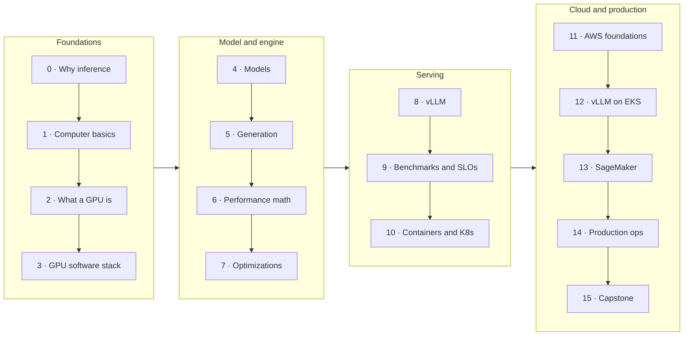

# AI Inference Academy: Curriculum

This document is the syllabus: audience, outcomes, the level sequence, learning paths, assessment and hardware/cost planning. The lessons themselves live in [`levels/`](levels/).

## 1. Audience and prerequisites

Two audiences share one sequence:
- **Platform / SRE / infra engineers** who have to run LLM inference in production.
- **ML / systems engineers** who want to understand what happens inside engines like vLLM.

Prerequisites: comfortable in Python or Go (ideally both); basic linear algebra (matrix multiply, softmax); Docker basics; basic Kubernetes (Pods, Deployments, Services) from level 10 on. No ML research background needed.

## 2. Learning outcomes

A graduate can:
1. **Do the back-of-envelope math:** given a model, GPU and workload, estimate weight memory, KV cache capacity, max concurrency, decode speed and $/1M tokens to within ~2× of measurement.
2. **Explain every major serving optimization** (KV cache, continuous batching, PagedAttention, prefix caching, chunked prefill, FlashAttention, CUDA graphs, quantization, speculative decoding, parallelism, disaggregation) by the bottleneck it attacks.
3. **Implement** the core of the key ones (KV cache, schedulers, paged allocation, prefix hashing, quantization, speculative sampling) and measure their effect.
4. **Operate** vLLM on Kubernetes and EKS: GPU scheduling, cold starts, probes, routing, autoscaling, observability, failure handling.
5. **Deploy and scale** the same service on SageMaker, and choose between EKS, SageMaker and managed APIs with numbers.
6. **Benchmark honestly:** open-loop load, realistic distributions, goodput at an SLO.
7. **Design** inference systems in an architecture review or interview, with explicit trade-offs.

## 3. Sequence

| Level | Core question | Key artifacts |
|---|---|---|
| 0 Why inference | What happens between "send" and the last token? | token timeline, `stream_timing.py` |
| 1 Computer basics | Is this computation limited by math or by memory? | `memory_vs_compute.py`, Little's Law |
| 2 What a GPU is | Which GPU spec matters for which part of inference? | CUDA/Triton kernels, GPU table |
| 3 GPU software stack | Why won't my container see the GPU? Where does time go? | `check_stack.sh`, profiler trace |
| 4 Models | What does config.json tell me about memory and compute? | BPE, `count_params.py`, GQA attention |
| 5 Generation | How do the KV cache and the sampler work? | NumPy Llama with exact KV cache, samplers, constrained decoding |
| 6 Performance math | Will it fit, how fast, and what does it cost? | `infercalc`, roofline |
| 7 Optimizations | Which technique removes which bottleneck? | batching sim, paged KV, quantization, speculative decoding |
| 8 vLLM | How do I run and tune a real engine? | serve/tune/metrics labs |
| 9 Benchmarks | How much can one replica serve at my SLO? | `loadgen`, sweep, report template |
| 10 Kubernetes | What changes when the workload is huge, slow-starting and stateful? | `gateway`, Compose/kind fleet, KEDA, GPU manifests |
| 11 AWS | Which instance, and how do I actually get one? | `pick_instance.py`, quota/capacity/storage/IAM |
| 12 EKS | How does it all fit together in production shape? | Auto Mode cluster, NodePool, vLLM, gateway, ALB, KEDA, dashboards, alerts, LWS |
| 13 SageMaker | What does the managed path give and cost? | BYOC image, boto3 deploy/invoke/autoscale, inference components |
| 14 Operations | How do I run this for a year? | cost model, rollout gates, failure-mode table, chaos drill |
| 15 Capstone | Can I build, measure and defend it, and design bigger ones? | capstone brief + rubric, 7 design cases, interview prep |

## 4. Learning paths

| Path | Levels | Approx. time (8 h/week) |
|---|---|---|
| **Full** | 0 → 15 | 10–12 weeks |
| **Platform fast track** | 0, 1, 5, 6, (7 skim), 8, 9, 10, 11, 12, 13, 14, 15 | 7–8 weeks |
| **Engine deep dive** | 0–9 in depth with all exercises, then 10, 12 | 7–8 weeks |
| **AWS-only refresher** (already knows inference) | 6, 9, 10, 11, 12, 13, 14 | 3–4 weeks |

## 5. Assessment

- **Every level:** self-check questions with answers, and labs with observable outcomes ("what to observe"). `scripts/test.sh` runs all automated lab tests.
- **Measured assignments:** levels 6, 8, 9, 10 and 12 each ask you to compare a prediction with a measurement and explain the gap.
- **Benchmark report** (level 9 template), reused in levels 12–15.
- **Capstone** (level 15) with a rubric covering estimation, measurement correctness, SLO attainment, cost, operability and reasoning, plus a 20-minute design review.

## 6. Hardware and cost tiers

| Tier | Hardware | Levels |
|---|---|---|
| **0: Laptop** | any machine with Python + Go (Docker + kind for level 10) | 0, 1, 4, 5, 6, 7, 9, 10 (mock fleet), 14 |
| **1: One GPU** | a 16–24 GB NVIDIA GPU: cloud g6/g5 by the hour, or a free notebook GPU for the 0.5B model | 2, 3, 8, 9 (real), 10 (GPU manifests), 12 (8B), 13 |
| **2: Multi-GPU** | 4–8 GPUs; p-family needs quota + usually a Capacity Block | 12 (70B, multi-node), 15 stretch goals |

Cost discipline: every AWS lab ships a cleanup script; the GPU NodePool has a hard GPU cap; set an AWS Budgets alarm before level 11.

## 7. Content status

| Area | Status |
|---|---|
| Levels 0–15 lessons | written |
| Laptop labs (levels 0, 1, 4–7, 9, 10, 14) | runnable and tested (`scripts/test.sh`, mock-fleet runs) |
| GPU labs (levels 2, 3, 8) | written against current PyTorch/Triton/vLLM APIs; need a GPU run to validate in your environment |
| AWS labs (levels 11–13) | written against current EKS Auto Mode, Karpenter v1, KEDA and SageMaker APIs; validate on a first run (check pinned versions, quotas, region) |

## 8. Core reading list

- Vaswani et al., *Attention Is All You Need* (2017) · Ainslie et al., *GQA* (2023)
- Pope et al., *Efficiently Scaling Transformer Inference* (2022) · Kipply, *Transformer Inference Arithmetic*
- Horace He, *Making Deep Learning Go Brrrr From First Principles*
- Yu et al., *Orca* (OSDI '22) · Kwon et al., *PagedAttention / vLLM* (SOSP '23) · Zheng et al., *SGLang*
- Dao et al., *FlashAttention* 1/2/3 · Agrawal et al., *Sarathi-Serve* (OSDI '24)
- Frantar et al., *GPTQ* · Lin et al., *AWQ* · Xiao et al., *SmoothQuant* · Dettmers et al., *LLM.int8()*
- Leviathan et al., *Fast Inference from Transformers via Speculative Decoding* (2023) · *Medusa* · *EAGLE*
- Shoeybi et al., *Megatron-LM* · Zhong et al., *DistServe* (OSDI '24) · Patel et al., *Splitwise* · Qin et al., *Mooncake*
- Gil Tene, *How NOT to Measure Latency* · Google SRE book (SLOs)
- Docs: vLLM, Kubernetes device plugins/DRA, KEDA, Karpenter, EKS (Auto Mode, AI/ML best practices), SageMaker inference
