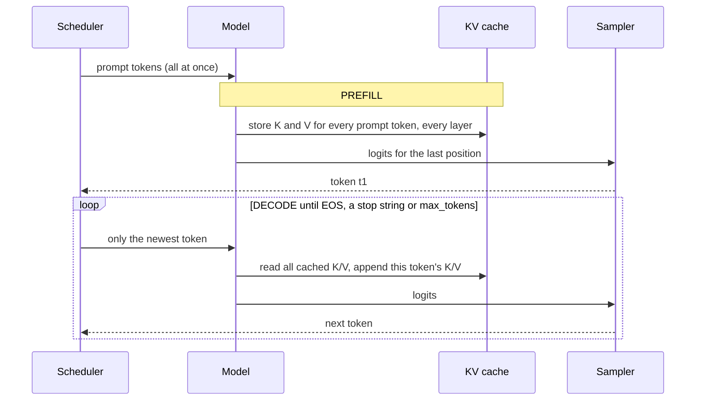

# Level 5: How generation works

> An LLM generates text one token at a time. The KV cache, prefill vs decode, and the sampler explain almost every behavior you'll see in production.

**You will:** implement autoregressive generation, prefill and decode, an exact KV cache, every common sampling method, and constrained (JSON) decoding. All of it in NumPy, all of it tested.
**Time:** 4–5 hours · **Hardware:** laptop (Tier 0)

---

## 1. Concepts

### 1.1 Autoregressive decoding



Without any cache, step *n* re-processes all *n* previous tokens, so generating N tokens costs O(N²) work.

### 1.2 The KV cache

Because of the causal mask (level 4), the keys and values of earlier tokens **never change**. So:

- **Prefill:** run the whole prompt in one forward pass, **store K and V** for every layer and every token, and output the first token.
- **Decode:** feed only the *newest* token, compute its q, k, v, append its k and v to the cache, and attend over the whole cache.

The output is **mathematically identical** (the lab tests this). The cost is memory:

```
KV bytes per token = 2 (K and V) × layers × kv_heads × head_dim × bytes_per_element
```

| Model | Per token (BF16) | One 8k-token sequence | 64 such sequences |
|---|---|---|---|
| Llama 3.1 8B (32 layers, 8 KV heads, 128 dim) | 128 KiB | 1 GiB | 64 GiB |
| Llama 3.1 70B (80 layers, 8 KV heads, 128 dim) | 320 KiB | 2.5 GiB | 160 GiB |

**The KV cache, not the weights, is usually what limits how many users one GPU can serve.** Most of level 7 (PagedAttention, prefix caching, FP8 KV, offloading) is about managing this memory.

### 1.3 Prefill vs decode, again

| | Prefill | Decode |
|---|---|---|
| Tokens per forward pass | the whole prompt (100s–100,000s) | 1 per sequence |
| Bottleneck | compute (matmuls) | memory bandwidth (weights + KV reads) |
| Sets | TTFT | ITL / TPOT |
| Scales with | prompt length | batch size and context length (KV reads) |

### 1.4 Sampling: from logits to a token

The model outputs a **logit** (unnormalized score) for each vocabulary entry. The sampler runs a pipeline:

1. **Penalties:** repetition / presence / frequency penalties adjust logits of tokens already generated.
2. **Temperature** `T`: divide logits by T. T→0 means greedy; T=1 keeps the model's own distribution; T>1 flattens it and raises randomness.
3. **Truncation:** **top-k** (keep the k most likely), **top-p** / nucleus (keep the smallest set whose probability mass reaches p), **min-p** (keep tokens with at least `min_p × p_max`).
4. **Sample** from what remains (or take the argmax for greedy).

Production notes:
- **Determinism:** greedy decoding on a GPU is *not* guaranteed bit-identical across runs, because batch composition changes the order of floating-point additions. Don't promise users "same input, same output".
- **Logprobs:** engines can return the log-probability of each chosen token. That's useful for evals, classification and confidence scores.
- **Stop conditions:** EOS token, user stop strings, `max_tokens`. A response that "cuts off mid-sentence" almost always hit `max_tokens` (`finish_reason: "length"`).

### 1.5 Structured output (JSON mode, tool calling)

To guarantee output matches a JSON schema or grammar, the engine **masks invalid tokens** at every step: their logits are set to −∞ before sampling. The schema is compiled into an automaton that says, given the text so far, which tokens may come next. vLLM supports several structured-output backends (e.g. xgrammar, guidance, outlines). The cost is a little CPU work per step. The benefit is zero parse errors.

---

## 2. Worked examples

**Example A: KV cache memory for a chatbot.** Llama 3.1 8B on a 24 GB L4 in BF16: weights 16.1 GB. With `--gpu-memory-utilization 0.9`, that leaves 21.6 GB − 16.1 GB − ~1.5 GB activations ≈ **4 GB for KV cache** ≈ 32k tokens. That's 4 users at 8k context, or 32 users at 1k context. Switch to FP8 weights (8 GB) plus FP8 KV (64 KiB/token) and you get ~12 GB of KV, ~190k tokens: **6× the concurrency on the same GPU.**

**Example B: why `temperature=0` still varies.** A user reports different answers to the same prompt at temperature 0. Under load, the request was batched with different neighbours, the matmul reduction order changed, two top logits within 1e-3 of each other swapped order, and the text diverged from that token onwards. The fix is product-level (don't rely on exact reproducibility), not a bug fix.

## 3. Labs

```bash
cd levels/05-how-generation-works/labs
python3 tiny_llama.py      # a full Llama-style model in NumPy: generate with and without KV cache
python3 sampling.py        # see how temperature, top-k, top-p, min-p reshape a distribution
python3 constrained.py     # a random "model" that can only emit valid JSON, thanks to masking
python3 -m unittest test_level05
```

Sample output of `tiny_llama.py`:

```
prompt 41 tokens, generate 48 tokens (greedy)
  without KV cache:   289.7 ms
  with KV cache:       48.0 ms   (6.0x faster, identical tokens)
  prefill 3.72 ms for 41 tokens; decode 0.92 ms per token
  cache now holds 88 tokens = 44 KiB in BF16 (2 x 4 layers x 2 kv_heads x 16 head_dim x 2 bytes per token)
```

Exercises:
1. Increase the prompt to 400 tokens and `n` to 200. How does the speed-up change, and why does it grow with length?
2. In `tiny_llama.py`, set `kv_heads = heads` (MHA). How much bigger is the cache?
3. Add **stop strings** to `generate_with_cache`: stop when the decoded output ends with any string in a list. What's tricky when a stop string spans two tokens?
4. Extend `constrained.py` so the allowed set is "any integer from 0 to 999". Hint: you don't need a trie of 1,000 strings; write the state machine.

## 4. Check yourself

<details><summary>1. Why is the KV cache exact rather than an approximation?</summary>
With causal attention, earlier tokens' K and V depend only on earlier tokens, which never change. Recomputing them gives the same numbers.</details>

<details><summary>2. Compute the KV cache of one 32k-token sequence for Llama 3.1 70B in BF16.</summary>
320 KiB × 32,768 ≈ 10 GiB. One long-context user can take more memory than many short-chat users together.</details>

<details><summary>3. top_p=0.9 with a very peaked distribution (top token p=0.95): how many tokens remain?</summary>
One. The top token alone already reaches 0.9 of the mass.</details>

<details><summary>4. A JSON-mode response is valid but semantically wrong. Did constrained decoding fail?</summary>
No. Constraints guarantee syntax and schema validity, not correctness. The model's logits still choose among the valid options.</details>

## 5. Going deeper
- Pope et al., *Efficiently Scaling Transformer Inference* (2022): KV cache, partitioning, the memory math
- Holtzman et al., *The Curious Case of Neural Text Degeneration* (nucleus sampling); Nguyen et al., min-p sampling
- Willard & Louf, *Efficient Guided Generation for LLMs* (Outlines); the XGrammar paper
- vLLM docs: Sampling Parameters, Structured Outputs

**Next → [Level 6: Performance math](../06-performance-math/README.md)**
