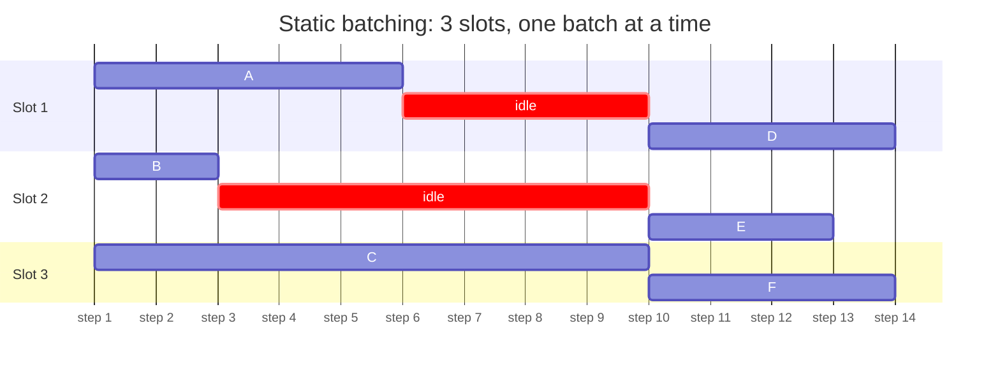
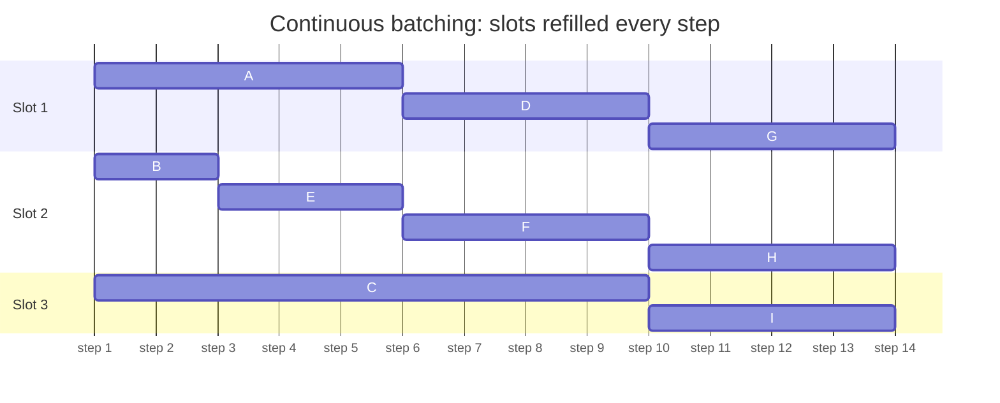
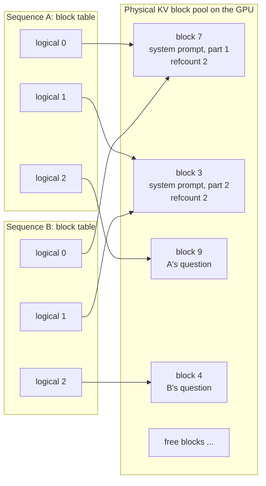
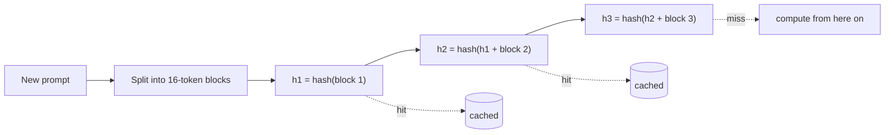
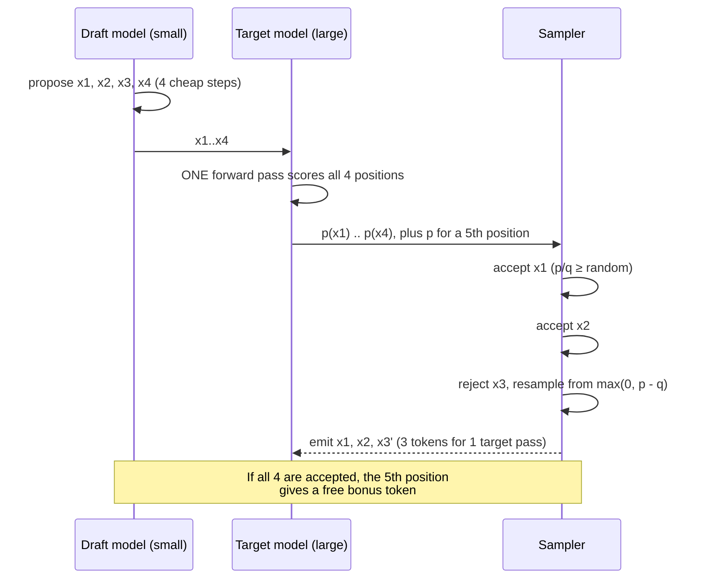
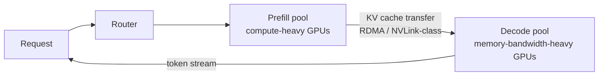

# Level 7: Inference optimizations

> Every optimization in vLLM, SGLang and TensorRT-LLM attacks a specific bottleneck. Learn the bottleneck first and the techniques follow from it.

**You will:** understand ten optimizations by the bottleneck each removes, and implement the core of four of them (batching scheduler, paged KV cache with prefix caching, quantization, speculative decoding) with tests.
**Time:** 6–8 hours · **Hardware:** laptop (Tier 0) for the labs

---

## 0. The map

| # | Optimization | Bottleneck it attacks | Main win | Trade-off |
|---|---|---|---|---|
| 1 | Continuous batching | GPU idle while batches drain | throughput, TTFT | scheduler complexity |
| 2 | PagedAttention | KV memory fragmentation | concurrency | indirection in attention kernels |
| 3 | Prefix caching | recomputing shared prompts | TTFT, GPU work | cache memory; needs routing affinity |
| 4 | Chunked prefill | long prefills stall decodes | ITL tail | slightly higher TTFT |
| 5 | FlashAttention | HBM traffic in attention | speed and memory at long context | kernel complexity |
| 6 | CUDA graphs and fusion | kernel launch overhead | decode step time | warm-up time, static shapes |
| 7 | Quantization | bytes per weight / KV entry | memory and decode speed | accuracy, must evaluate |
| 8 | Speculative decoding | decode is serial | per-user speed at low batch | wasted work at high batch |
| 9 | Parallelism (TP/PP/EP) | model doesn't fit / too slow on one GPU | capacity, latency | communication overhead |
| 10 | Disaggregated prefill/decode | prefill and decode interfere | goodput at strict SLOs | KV transfer, more moving parts |

---

## 1. Continuous batching (iteration-level scheduling)

**Static batching:** collect B requests, run them together until **all** finish. Short answers sit idle waiting for the longest one, and new requests wait for the next batch.

**Continuous batching** (Orca, 2022): the scheduler makes a decision **every step**. Finished sequences leave immediately and waiting ones join immediately. The GPU always runs the fullest batch it can.

**Static batching.** C runs for 9 steps, so A and B hold their slots after finishing, and D waits for the whole batch:



**Continuous batching.** The scheduler refills each slot the step after it frees up:



The scheduler's job each step: pick which waiting requests to admit, subject to a max batch size (`--max-num-seqs`), a token budget per step (`--max-num-batched-tokens`) and available KV blocks. If memory runs out mid-generation, it **preempts** a sequence (frees its blocks and recomputes them later), which shows up as latency spikes.

## 2. PagedAttention

Older servers reserved `max_model_len` tokens of contiguous KV memory per request. A 200-token chat wasted almost all of an 8k reservation, so 60–80% of KV memory went unused.

**PagedAttention** (vLLM, 2023) borrows virtual memory from operating systems:
- The KV cache is a pool of fixed-size **blocks** (vLLM default: 16 tokens).
- Each sequence has a **block table** mapping its logical blocks to physical blocks, like a page table.
- Blocks are allocated only as tokens are generated, so waste is at most one partial block per sequence.
- Blocks can be **shared** (reference-counted) between sequences: parallel samples (`n > 1`), beam search and common prefixes. A shared block is **copied on write**.
- The attention kernel reads K/V by following the block table.

Two sequences sharing a 2-block prefix, with 4-token blocks:



## 3. Prefix caching

Chat traffic repeats itself: the same system prompt, few-shot examples, tool definitions, document, or conversation history on every turn. With **automatic prefix caching**, each full KV block is identified by a **hash of its tokens and of all tokens before it** (a hash chain). A new request looks up its prefix blocks. Cache hits skip prefill entirely for those tokens.

- A 2,000-token system prompt plus a 50-token question means ~97% of prefill is skipped on a hit. TTFT drops from hundreds of ms to tens.
- The cache lives **on one replica**. With 10 replicas and round-robin routing, each prefix is cached 10 times and hit rarely. That's why **prefix-aware routing** (level 10) matters.
- SGLang's RadixAttention stores prefixes in a radix tree. The idea is the same.

How a new request finds its cached prefix:



A block only matches if every block before it matched too, because each hash includes the previous one.

## 4. Chunked prefill

A 16k-token prompt arriving in a continuous batch makes one step take hundreds of milliseconds, and **every** other user's next token waits. **Chunked prefill** caps the tokens per step (e.g. 512–8192) and splits long prompts across steps, mixed with the ongoing decodes. ITL tails flatten. The cost is a somewhat higher TTFT for the long prompt itself. (Sarathi-Serve, 2024; enabled by default in recent vLLM.)

## 5. FlashAttention

Naive attention materializes the T×T score matrix in HBM: write scores, read them for softmax, write probabilities, read them for the V multiply. **FlashAttention** tiles q, k and v into SRAM-sized blocks and computes the softmax **online** (a running max and sum), so the T×T matrix never touches HBM. The result is exact, uses O(T) memory instead of O(T²), and is much faster at long context. FlashDecoding / split-KV extends it to decode with long caches by parallelizing over the KV length. FlashInfer and FlashAttention 2/3 are the kernels vLLM and SGLang use.

## 6. CUDA graphs and kernel fusion

A decode step is hundreds of small kernels, and launching each one costs microseconds of CPU time. **CUDA graphs** capture the step once per batch size and replay it with a single launch. **Fusion** merges elementwise ops (RMSNorm + residual, RoPE, SwiGLU activation) into neighbouring kernels to avoid HBM round trips. Both are why a vLLM decode step is far faster than `transformers.generate()` on the same GPU. It's also why vLLM's startup includes "capturing CUDA graphs".

## 7. Quantization

| Method | What is quantized | Notes |
|---|---|---|
| Weight-only INT8 / INT4 (**GPTQ**, **AWQ**) | weights; activations stay BF16 | INT4 at group size 128 is common; big memory and decode win; dequantized inside the matmul kernel |
| **FP8** (W8A8) | weights and activations, per-tensor/channel scales | native on L4/L40S/H100/H200; ~2× memory and good speed; usually small quality loss |
| **SmoothQuant** | moves activation outliers into weights, then INT8 W8A8 | handles activation outliers |
| **KV cache FP8** | the cache | ~2× more context/users; check long-context quality |
| GGUF (llama.cpp) | many k-quant types | CPU / Apple Silicon / edge |

Two rules: (1) decode speed tracks **bytes per weight**, so quantization is a throughput and capacity tool as well as a memory tool; (2) **always evaluate on your own task**. Perplexity can look fine while a coding or math benchmark drops.

## 8. Speculative decoding

A cheap **draft** proposes k tokens. The **target** model checks all k in one forward pass, which costs about the same as one decode step, because decode is memory-bound and k extra tokens add little. Accept each draft token with probability `min(1, p/q)`. On rejection, resample from the residual `max(0, p − q)`. **The output distribution is exactly the target's.**

Expected tokens per target pass with acceptance rate α: `(1 − α^(k+1)) / (1 − α)`.

Draft sources: a small model from the same family, **n-gram / prompt lookup** (copy from the prompt; great for summarization, RAG and code edits), **Medusa** heads, **EAGLE** (a light draft head on the target's features, typically the best acceptance). **Caveat:** at high batch sizes decode becomes compute-bound, verification stops being nearly free, and speculation can *reduce* throughput. It's a latency tool for low-to-moderate load.

One speculative step with k = 4:



## 9. Parallelism

| Strategy | Split | Communication | Use when |
|---|---|---|---|
| **Tensor parallel (TP)** | each layer's matrices across GPUs | 2 all-reduces per layer, latency-critical | model doesn't fit on one GPU; within a node on NVLink |
| **Pipeline parallel (PP)** | layers across GPUs/nodes | activations between stages | across nodes; tolerates slower links; adds pipeline bubbles |
| **Data parallel (replicas)** | whole model copies | none | the model fits: **always prefer replicas** for throughput |
| **Expert parallel (EP)** | MoE experts across GPUs | all-to-all per MoE layer | large MoE models |
| **Context/sequence parallel** | the sequence | ring attention | very long context |

Rule: use the smallest TP that fits with reasonable KV room, keep TP inside an NVLink domain, then scale with replicas.

## 10. Disaggregated prefill and decode

Prefill (compute-bound, bursty) and decode (memory-bound, steady) interfere when they share a GPU. **Disaggregation** runs them on separate pools and ships the KV cache from prefill to decode workers over a fast interconnect (RDMA/NVLink-class transfer libraries). It improves goodput under strict TTFT and ITL SLOs at scale, at the cost of KV transfer and operational complexity (DistServe, Splitwise, Mooncake; NVIDIA Dynamo and llm-d productize the idea). Below large scale, chunked prefill usually captures most of the benefit.

---



## Labs

```bash
cd levels/07-inference-optimizations/labs
python3 batching_sim.py   # static vs continuous vs chunked prefill on the same workload
python3 paged_kv.py       # block tables, prefix sharing, copy-on-write, fragmentation
python3 quantize.py       # INT8 per-channel and INT4 group-wise: size vs error, outliers
python3 speculative.py    # proof of losslessness + speed-up table
python3 -m unittest test_level07
```

Sample output of `batching_sim.py`:

```
static batching (16)                   782 tok/s    13113    26003 ms TTFT p50/p99   10.4   10.4 ms ITL p50/p99
continuous batching                   2231 tok/s      204      790 ms TTFT p50/p99   17.6  180.7 ms ITL p50/p99
continuous + chunked prefill 512      2171 tok/s      622     1265 ms TTFT p50/p99   22.6   26.4 ms ITL p50/p99
```

Read it like an engineer:
- Continuous batching gives ~3× the throughput and ~60× better median TTFT than static batching.
- Without chunking, ITL p99 is 180 ms: the long prompts freeze everyone. Chunking brings it to 26 ms and **costs TTFT**. That's the trade-off the `--max-num-batched-tokens` setting controls.

Exercises:
1. `batching_sim.py`: sweep `chunk_tokens` over 128, 512, 2048, 8192 and plot TTFT p50 against ITL p99. Where would you set it for a chat product, and for a batch-summarization product?
2. `paged_kv.py`: add **LRU eviction statistics** and a workload of 50 conversations × 5 turns where each turn's prompt is the previous turn's prompt + answer + new question. What hit rate do you get with 64 vs 512 blocks?
3. `quantize.py`: implement **AWQ-style scaling**. Scale up the input channels with the largest activations before quantizing, scale the activations down by the same factor, and measure the error reduction with outlier activations.
4. `speculative.py`: add a "batch size" parameter where verification costs `1 + 0.02 × batch × k` steps. Find the batch size where speculation stops helping.

## Check yourself

<details><summary>1. Which optimization would you look at first for each symptom: (a) TTFT high only for users with a long shared system prompt; (b) ITL p99 spikes when someone pastes a document; (c) the server fits 10 concurrent users but memory looks half empty?</summary>
(a) Prefix caching, plus prefix-aware routing. (b) Chunked prefill (lower `max-num-batched-tokens`). (c) Fragmentation or over-reservation: PagedAttention (in vLLM already), or `max-model-len` set far larger than needed.</details>

<details><summary>2. Why does prefix caching need help from the router?</summary>
The cache is per replica. Requests sharing a prefix only hit it if they land on the replica that holds those blocks.</details>

<details><summary>3. Is speculative decoding lossy?</summary>
No. With correct rejection sampling, the output distribution equals the target model's. Only speed changes.</details>

<details><summary>4. You can serve a 70B model with TP=8 on one 8-GPU node, or with 2 replicas at TP=4. Which is usually better for throughput, and why?</summary>
Two TP=4 replicas, if each has enough KV room. Less communication per token, and two independent schedulers. TP=8 gives lower per-token latency and more KV memory per replica.</details>

## Going deeper
- Yu et al., *Orca* (OSDI '22) · Kwon et al., *PagedAttention / vLLM* (SOSP '23) · Zheng et al., *SGLang* (RadixAttention)
- Agrawal et al., *Sarathi-Serve* (OSDI '24) · Dao et al., *FlashAttention 1/2/3*
- Frantar et al., *GPTQ* · Lin et al., *AWQ* · Xiao et al., *SmoothQuant* · Dettmers et al., *LLM.int8()*
- Leviathan et al. / Chen et al., speculative decoding (2023) · Cai et al., *Medusa* · Li et al., *EAGLE*
- Shoeybi et al., *Megatron-LM* · Zhong et al., *DistServe* · Patel et al., *Splitwise* · Qin et al., *Mooncake*

**Next → [Level 8: Running models and vLLM](../08-running-models-and-vllm/README.md)**
