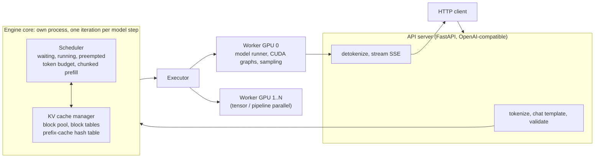
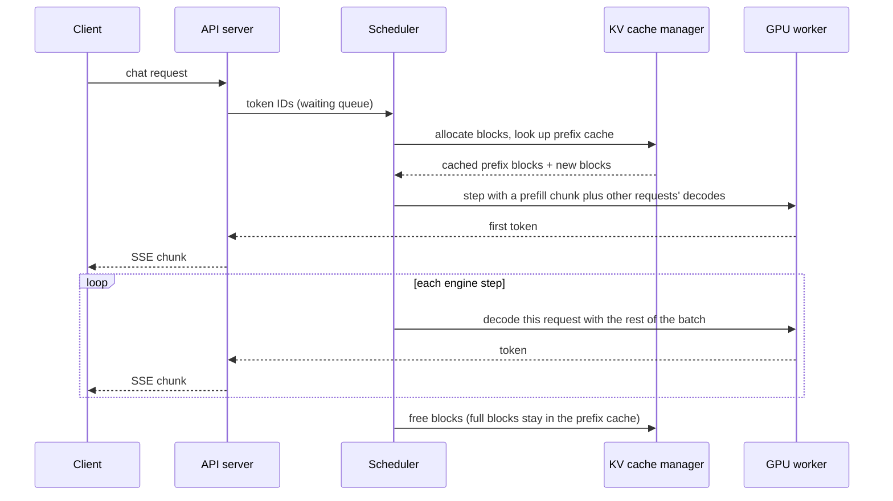

# Level 8: Running models, from laptop to vLLM

> vLLM implements level 7 for you. This level is about using it well: its architecture, the flags that matter, its API and its metrics.

**You will:** run models with Transformers, llama.cpp/Ollama and vLLM; understand vLLM's architecture; tune its memory flags; use its OpenAI-compatible API and its metrics.
**Time:** 4–6 hours · **Hardware:** a 24 GB GPU (Tier 1: g6.xlarge/g5.xlarge, or Colab for the 0.5B model)

---

## 1. Concepts

### 1.1 The engine landscape

| Engine | Strengths | Typical use |
|---|---|---|
| HF Transformers `generate()` | simplest, every model | research, correctness reference; slow for serving |
| llama.cpp / Ollama | CPU, Apple Silicon, GGUF quantization, one binary | laptops, edge, dev |
| **vLLM** | PagedAttention, continuous batching, broad model and hardware support, OpenAI API, huge community | **default choice for GPU serving** |
| SGLang | RadixAttention, fast structured generation, strong for agents and multi-call programs | high-throughput and agentic workloads |
| TensorRT-LLM | compiled engines tuned for NVIDIA GPUs | maximum NVIDIA performance, more build effort |
| HF TGI | earlier popular server | existing deployments; check project status before adopting |
| NVIDIA Dynamo, llm-d | orchestration *around* engines: disaggregation, KV-aware routing | large fleets (level 14) |

### 1.2 vLLM architecture



One request's path through the engine:



### 1.3 The flags that matter

| Flag | What it controls | Rule of thumb |
|---|---|---|
| `--model`, `--served-model-name` | weights to load / name clients use | serve a stable alias, not the HF id |
| `--max-model-len` | max prompt + output tokens per request | set to what users need, **not** the model's maximum. Halving it can double concurrency |
| `--gpu-memory-utilization` | fraction of GPU memory for weights + KV pool | 0.85–0.92; lower if the GPU is shared or you see OOMs |
| `--max-num-seqs` | max sequences per step | caps batch size: higher means more throughput and slower per-user tokens |
| `--max-num-batched-tokens` | tokens per step (chunked prefill budget) | lower means smoother ITL; higher means better TTFT/throughput for long prompts |
| `--tensor-parallel-size`, `--pipeline-parallel-size` | multi-GPU split | smallest that fits (level 7) |
| `--enable-prefix-caching` | automatic prefix caching | on for chat and agents (default on in recent versions) |
| `--quantization`, `--kv-cache-dtype fp8` | quantized weights / KV | use a pre-quantized checkpoint (AWQ, GPTQ, FP8) when available |
| `--enable-lora`, `--max-loras` | serve LoRA adapters on one base model | multi-tenant fine-tunes (level 15 case study) |
| `--speculative-config` | speculative decoding | latency at low load; measure at your real batch size |
| `--enable-chunked-prefill` | chunked prefill | default on in recent versions |

Flag names and defaults change between releases. **Pin the version** and check `vllm serve --help` for it.

### 1.4 Reading the startup log

Abridged and illustrative; the exact wording changes between versions:

```
Loading weights took 15.2 GB / 6.3 s                           <- level 4/6: params × bytes
Memory profiling: ... activations peak 1.4 GiB
Available KV cache memory: 3.9 GiB                             <- formula 3 in level 6
GPU KV cache size: 31,904 tokens                               <- 3.9 GiB / 128 KiB per token
Maximum concurrency for 8,192 tokens per request: 3.89x        <- full-length sequences that fit
Capturing CUDA graphs (decode, batch sizes 1..512) ... 12 s    <- level 7.6
```

If your level 6 calculation and this log disagree by more than ~20%, find out why. It's usually overhead, `max-model-len`, or the dtype.

### 1.5 The API

vLLM exposes OpenAI-compatible endpoints: `/v1/chat/completions`, `/v1/completions`, `/v1/embeddings` (for embedding models), `/v1/models`, plus `/health` and `/metrics`. Any OpenAI SDK works by changing `base_url`. vLLM-specific sampling options (`top_k`, `min_p`, `repetition_penalty`, `ignore_eos`, structured-output options) go in `extra_body`.

### 1.6 Metrics you'll use for the rest of the course

| Metric | Type | Meaning | Used for |
|---|---|---|---|
| `vllm:num_requests_running` | gauge | sequences in the current batch | load, concurrency |
| `vllm:num_requests_waiting` | gauge | queued, not yet scheduled | **saturation**, autoscaling |
| `vllm:kv_cache_usage_perc` | gauge (0–1) | KV block pool usage | memory pressure, preemption risk |
| `vllm:time_to_first_token_seconds` | histogram | TTFT | SLO |
| `vllm:inter_token_latency_seconds` | histogram | ITL | SLO |
| `vllm:e2e_request_latency_seconds` | histogram | end-to-end latency | SLO |
| `vllm:prompt_tokens_total`, `vllm:generation_tokens_total` | counters | tokens processed | throughput, cost attribution |
| `vllm:prefix_cache_queries_total`, `vllm:prefix_cache_hits_total` | counters | prefix cache lookups / hits (tokens) | cache hit rate, routing quality |

Names have changed across versions (e.g. `gpu_cache_usage_perc` → `kv_cache_usage_perc`, `time_per_output_token_seconds` → `inter_token_latency_seconds`). The academy's `mockllm` uses the current names, so dashboards and autoscalers you build against it carry over.

---

## 2. Worked example: fixing a startup OOM

You launch Llama 3.1 8B on a 24 GB L4 with defaults and see:

```
ValueError: The model's max seq len (131072) is larger than the maximum number of tokens
that can be stored in KV cache (31904). Try increasing gpu_memory_utilization or decreasing max_model_len.
```

The model supports 128k context. One 128k sequence needs 128k × 128 KiB = **16 GiB** of KV, but only 3.9 GiB is free. Fixes, in order of preference:
1. `--max-model-len 8192`: the product only needs 8k. Done.
2. `--kv-cache-dtype fp8`: twice the tokens.
3. An FP8 model checkpoint (frees ~8 GB of weights for KV).
4. A 48 GB L40S (g6e) if users really need long context.

## 3. Labs

```bash
cd levels/08-running-models-and-vllm/labs
./serve_vllm.sh                                   # Qwen2.5-0.5B, ungated; watch the startup log
MODEL=meta-llama/Llama-3.1-8B-Instruct HF_TOKEN=hf_... ./serve_vllm.sh   # the course's running example
pip install openai && python3 client.py           # streaming, JSON schema, vLLM extras
./watch_metrics.sh http://localhost:8000          # live scheduler state while you send load
pip install vllm && python3 offline_batch.py --n 512   # offline throughput, no HTTP
```

No GPU yet? Everything except `serve_vllm.sh` and `offline_batch.py` works against the mock: `go run ./platform/cmd/mockllm`, then `python3 client.py`. The structured-output step needs real vLLM.

Assignments:
1. **Calculator vs reality:** record "Available KV cache memory", "GPU KV cache size" and "Maximum concurrency" for 8B at `--max-model-len` 4096, 8192 and 32768. Compare with `infercalc`.
2. **Concurrency vs speed:** using `platform/cmd/loadgen` in closed-loop mode, run `-concurrency 1, 4, 16, 64`. Plot aggregate output tok/s and per-user TPOT. Match the shape to level 6's prediction.
3. **Prefix caching:** run loadgen with `-prefix-tokens 2000 -prefix-groups 4` with prefix caching on, then with `--no-enable-prefix-caching`. Compare TTFT p50 and the hit rate shown by `watch_metrics.sh`.
4. **Online vs offline:** compare `offline_batch.py` tok/s with the best online tok/s that met a 1 s TTFT p95. Why is offline always higher?

## 4. Check yourself

<details><summary>1. Which two flags most often fix "not enough KV cache" at startup?</summary>
`--max-model-len` (lower it to what you need) and `--gpu-memory-utilization` (raise it slightly if the GPU isn't shared). Next come FP8 KV and quantized weights.</details>

<details><summary>2. What does a sustained non-zero `vllm:num_requests_waiting` mean?</summary>
The replica is saturated: it can't admit requests as fast as they arrive, limited by `max-num-seqs`, the token budget or KV blocks. TTFT will grow. Scale out or shed load.</details>

<details><summary>3. Why serve with `--served-model-name llama-3.1-8b` instead of the HF repo id?</summary>
Clients and gateways bind to a stable alias, so you can swap checkpoints (quantized, fine-tuned, new revision) without changing callers.</details>

## 5. Going deeper
- vLLM docs: engine arguments, optimization and tuning, production metrics, structured outputs, LoRA, speculative decoding
- vLLM blog posts on the V1 engine architecture
- SGLang docs; TensorRT-LLM docs (for comparison in level 14)

**Next → [Level 9: Benchmarking and SLOs](../09-benchmarking-and-slos/README.md)**
