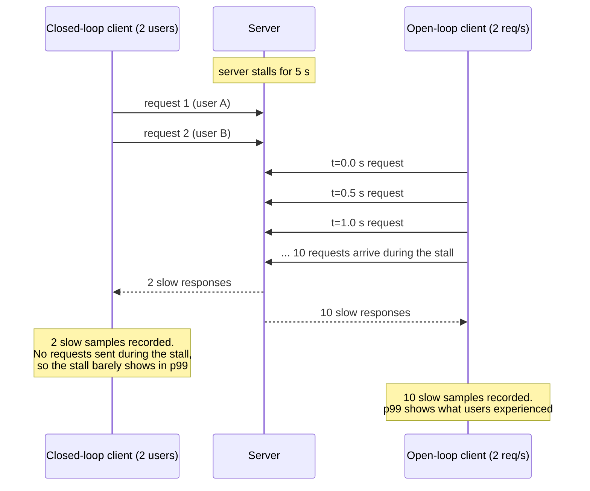

# Level 9: Benchmarking and SLOs

> A benchmark answers one question: how much traffic can this setup serve while meeting its latency promise? Most published LLM benchmarks measure something else.

**You will:** define SLOs for different products, learn open- vs closed-loop load and coordinated omission, measure goodput, and run a capacity sweep with the academy's Go load generator.
**Time:** 4–5 hours · **Hardware:** laptop with the mock (Tier 0); a GPU for the real runs (Tier 1)

---

## 1. Concepts

### 1.1 SLOs depend on the product

| Product | TTFT p95 | ITL / TPOT p95 | Notes |
|---|---|---|---|
| Chat assistant | < 1 s | < 50–100 ms (10–20+ tok/s; faster than reading speed) | users watch the stream |
| Code autocomplete | < 200–300 ms end to end | — (short outputs) | latency above all; small models, short prompts |
| Agent / tool loop | moderate | high tokens/s | many sequential calls: per-call latency compounds |
| RAG over long documents | < 2–3 s | < 100 ms | prefill-heavy; prefix caching matters |
| Batch / offline (evals, labeling) | none | none | **throughput and $/token only** |

An SLO is a percentile + a threshold + a window: *"p95 TTFT < 1 s and p95 TPOT < 60 ms, measured over 5-minute windows, 99% of windows."*

### 1.2 Throughput vs goodput

- **Throughput:** tokens/s or requests/s the server produced.
- **Goodput:** requests/s that **met the SLO**. A server pushed past its knee keeps raising throughput a little while goodput collapses, because everyone is served too slowly.

The headline number for a deployment is **max goodput per replica** (or per dollar) at your SLO.

### 1.3 Closed loop vs open loop

| | Closed loop | Open loop |
|---|---|---|
| How | N virtual users; each sends its next request after the previous one finishes | requests arrive on a clock (e.g. Poisson at λ req/s), regardless of completions |
| Models | a fixed pool of clients (batch jobs, load tests with a concurrency knob) | real users (they don't wait for each other) |
| Under overload | **arrival rate drops automatically**, which hides the problem | queue grows, latency explodes, which **shows the problem** |

### 1.4 Coordinated omission

In a closed loop, when the server stalls for 5 s, your 8 virtual users also stall, so no requests are *sent* during the stall and none are measured as slow. The benchmark "coordinates" with the server and **omits** exactly the samples that would have shown the problem. Percentiles look great; production users see 5 s spikes. Open-loop load (the academy loadgen's `-rate`) avoids this. The arrival schedule is computed up front and never waits for responses.

The same 5-second server stall, seen by each kind of load generator:



### 1.5 Making the workload realistic

- **Length distributions matter more than averages.** 90% short chats plus 10% long documents behaves very differently from "everyone sends 500 tokens".
- **Output length:** benchmarks often set `ignore_eos` so outputs are exactly `max_tokens`. Production outputs vary, so model both.
- **Prefix reuse:** real traffic shares system prompts and history. Random prompts understate prefix-cache benefit, and identical prompts overstate it. The academy loadgen has `-prefix-tokens` and `-prefix-groups` to control this.
- **Warm-up:** the first requests pay for CUDA graph capture, cache warm-up and connection setup. Discard them or run long enough.
- **Reproducibility:** record the engine version, flags, GPU, driver, model revision, workload seed and client location. One flag change can move results by 2×.

### 1.6 Little's Law, again

`concurrency = throughput × latency`. A replica with `--max-num-seqs 16` and requests taking ~3.7 s each tops out near 16 / 3.7 ≈ **4.3 req/s**. At 6 req/s the queue grows forever and TTFT climbs without bound. Your sweep should show exactly this knee.

---

## 2. Worked example: a capacity sweep (on the mock)

```bash
go run ./platform/cmd/mockllm -addr :8000 -max-num-seqs 16 &
RATES="2 4 6 8" N=200 levels/09-benchmarking-and-slos/labs/sweep.sh http://localhost:8000
```

Measured result (prompt 256–1024 tokens, output 64–256, SLO TTFT ≤ 500 ms, TPOT ≤ 50 ms):

```
rate     req/s      out_tok/s    ttft_p95     tpot_p95     slo_met
2        2.14       330          200          20.9         100.0%
4        3.68       585          1493         23.3         56.5%
6        3.87       616          7879         23.3         25.0%
8        4.02       627          21428        23.4         8.0%
```

- Throughput plateaus at ~4 req/s, as Little's Law predicted.
- **TPOT barely moves**, because the batch size is capped at 16. All the damage is in **TTFT** (queueing).
- Attainment is already 56% at 4 req/s. The real capacity at a 95% target sits between 2 and 4 req/s. Refine the sweep (`RATES="2 2.5 3 3.5"`) to find it. That number is what you use for capacity planning and autoscaling (level 12).

## 3. Labs

```bash
cd platform
go run ./cmd/loadgen -h
# closed loop: 8 users
go run ./cmd/loadgen -url http://localhost:8000 -concurrency 8 -n 200
# open loop: Poisson 5 req/s with an SLO
go run ./cmd/loadgen -url http://localhost:8000 -rate 5 -n 300 -slo-ttft 500ms -slo-tpot 50ms -out run.json
# shared prefixes (system prompts) for prefix-cache experiments
go run ./cmd/loadgen -url http://localhost:8000 -rate 5 -n 300 -prefix-tokens 2000 -prefix-groups 8
```

Assignments:
1. **Coordinated omission, demonstrated:** start the mock with `-max-num-seqs 4`. Run closed-loop `-concurrency 4` and open-loop `-rate 3`. Compare TTFT p99. Which one tells the truth about user experience?
2. **Find the knee** for the mock with `sweep.sh`, then do the same against real vLLM on a GPU (8B on an L4 or A10G). Record max goodput per replica at your SLO. You'll reuse this number in levels 12–14.
3. **Cross-check the tool:** run `vllm_bench.sh` and the equivalent loadgen command. TTFT/TPOT p50 should agree within ~5–10%. If they don't, explain why (tokenization differences, client location, warm-up).
4. **Write a benchmark report** (template below) for one configuration.

### Benchmark report template

```
System:     model / revision / dtype / engine+version / key flags / GPU / driver / instance
Workload:   arrival process + rate, prompt and output length distributions, prefix reuse, seed, duration
SLO:        TTFT p95 <= X, TPOT p95 <= Y
Results:    table per rate: req/s, out tok/s, TTFT p50/p95/p99, TPOT p50/p95, error rate, SLO attainment
Answer:     max goodput per replica at SLO = N req/s (M tok/s); $/1M tokens at that point
Caveats:    what would change the answer (longer prompts, different prefix reuse, ...)
```

## 4. Check yourself

<details><summary>1. Why can a closed-loop benchmark report a fine p99 for a server that's overloaded?</summary>
When the server slows down, the fixed pool of clients sends fewer requests, so the overload never shows up as long queues (coordinated omission).</details>

<details><summary>2. In the sweep above, throughput rose ~4% from rate 6 to rate 8 while SLO attainment fell from 25% to 8%. Which number goes in the capacity plan?</summary>
Neither of those. Use the highest rate where attainment still meets your target (e.g. ≥ 95%). Past the knee, extra throughput comes from making users wait longer.</details>

<details><summary>3. Why must sweep runs use different random seeds when prefix caching is on?</summary>
With the same seed, every run sends the same prompts, so later runs hit blocks cached by earlier runs and look faster than they really are.</details>

## 5. Going deeper
- Gil Tene, *How NOT to Measure Latency* (coordinated omission)
- vLLM benchmarking docs (`vllm bench serve`), GuideLLM, NVIDIA GenAI-Perf
- Zhong et al., *DistServe*: the goodput-at-SLO framing

**Next → [Level 10: Containers and Kubernetes for GPUs](../10-containers-and-kubernetes/README.md)**
