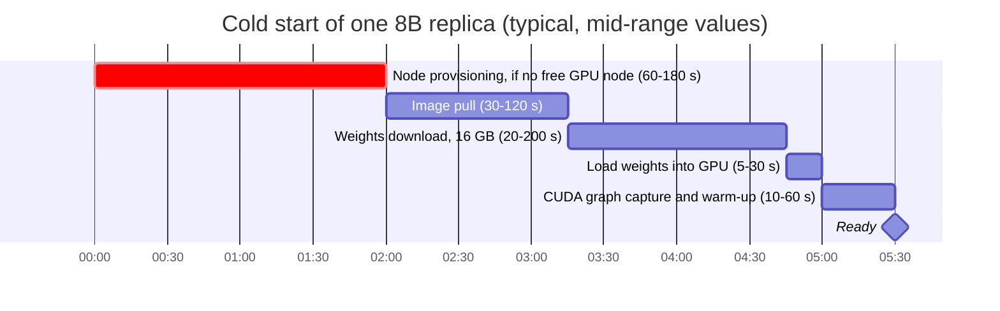
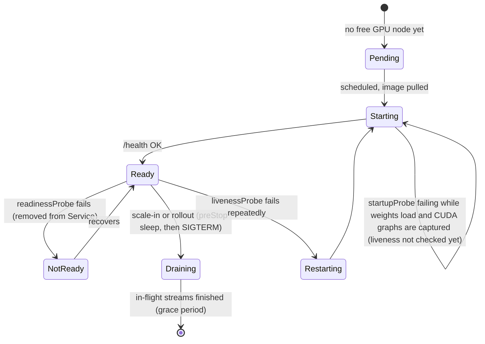
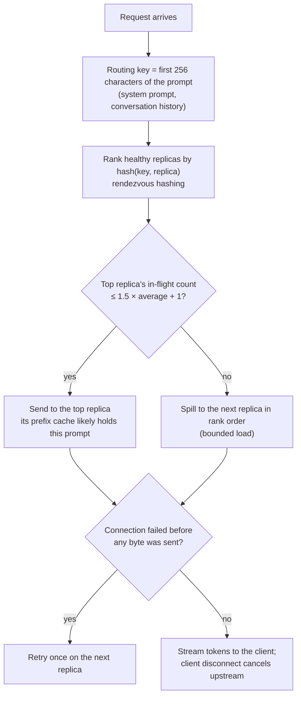

# Level 10: Containers and Kubernetes for GPUs

> Kubernetes was built for stateless CPU services. LLM servers are huge, slow to start, stateful (their KV cache) and run on scarce, expensive hardware. This level covers what changes because of that.

**You will:** containerize inference, analyse cold starts, schedule GPUs in Kubernetes, write probes for slow starters, route LLM traffic properly, and autoscale on the right signal. Most of it runs on a laptop.
**Time:** 6–8 hours · **Hardware:** laptop + Docker + kind (Tier 0); a GPU cluster for 10d–10f (Tier 1)

---

## 1. Concepts

### 1.1 GPU containers

- The container holds the **user-space** stack (CUDA runtime, PyTorch, the engine). The **host** provides the kernel driver.
- The **NVIDIA Container Toolkit** is the bridge. `docker run --gpus all` (or the Kubernetes device plugin) exposes `/dev/nvidia*` and mounts the driver's user-space libraries into the container.
- Images are big. `vllm/vllm-openai` is several GB compressed and around 10 GB+ unpacked. Image pull is a real part of cold start.
- **Shared memory:** multi-GPU inference uses `/dev/shm` for NCCL. Docker's 64 MB default breaks it. Use `--ipc=host` or mount a memory-backed `emptyDir` at `/dev/shm` in Kubernetes.

### 1.2 Model weights are not code

| Where weights live | Cold start | Pros | Cons |
|---|---|---|---|
| Baked into the image | image pull (huge) | one artifact, immutable | 16–140 GB images, slow CI, registry costs |
| Downloaded from the HF Hub at start | network + HF rate limits | simplest | slow; depends on an external service; gated-model tokens in pods |
| **Object storage (S3) → local disk at start** | in-region S3 throughput | fast, private, versioned | needs IAM and an init step |
| Shared filesystem (FSx for Lustre, EFS) or a PVC | mount + read | download once, share across pods | a filesystem to operate; throughput limits |
| Streamed straight to GPU memory (model streamers) | overlaps download and load | fastest for big models | engine and format support needed |

**Anatomy of a cold start** (8B on one GPU, typical orders of magnitude):



Total: about 2 to 10 minutes, so autoscaling has to react early (level 12).

### 1.3 GPUs in Kubernetes

- The **device plugin** (or the **NVIDIA GPU Operator**, which also manages drivers, the toolkit and DCGM) advertises `nvidia.com/gpu: N` on each node.
- Pods request whole GPUs: `resources.limits: {nvidia.com/gpu: 1}`. No fractions without sharing features.
- **Taint** GPU nodes (`nvidia.com/gpu:NoSchedule`) so CPU pods don't squat on $30/hour machines, and give GPU pods the matching **toleration**.
- **Node affinity/selectors** pin workloads to GPU types (e.g. `eks.amazonaws.com/instance-family: g6`).
- **Sharing a GPU:**

| Mechanism | Isolation | Granularity | Use |
|---|---|---|---|
| Time-slicing | none (memory and faults shared) | N virtual GPUs per GPU | dev/test, tiny models |
| MPS | partial | processes share SMs concurrently | many small inference processes |
| **MIG** (A100/H100/H200) | hardware: memory + SMs + faults | up to 7 slices | multi-tenant small models |
| **DRA** (Dynamic Resource Allocation) | depends on driver | structured requests ("a GPU with ≥ 40 GB") | the newer Kubernetes API for devices |

### 1.4 Probes and lifecycle for slow, stateful servers

- **startupProbe** with a long budget (10–20 minutes). Without it, the liveness probe kills the pod while it's still loading weights, and it restarts forever.
- **readinessProbe** on `/health`: only route traffic after the model is loaded.
- **Graceful shutdown:** `preStop` sleep (let endpoints update), then SIGTERM, and a `terminationGracePeriodSeconds` longer than your longest generation.
- **Rollouts:** `maxUnavailable: 0, maxSurge: 1`. Never drop capacity, and accept that a rollout needs a spare GPU.
- **PodDisruptionBudget:** stops node drains from evicting all replicas at once.

A vLLM pod's lifecycle with correct probes:



### 1.5 Routing: why round-robin fails for LLMs

Classic load balancers assume requests cost about the same. LLM requests vary **1000×** (10 vs 10,000 prompt tokens, 5 vs 2,000 output tokens), and replicas hold **state** (prefix caches).

| Policy | Signal | Problem it solves | Weakness |
|---|---|---|---|
| Round-robin | none | — | ignores load and caches |
| Least-connections / least-loaded | in-flight requests | uneven request cost | still ignores caches |
| Engine-load-aware | `num_requests_waiting`, KV usage scraped from engines | real saturation | slightly stale metrics |
| **Prefix/KV-cache-aware** | hash of the prompt prefix (or the engines' actual cache state) | prefix cache hits → TTFT and GPU savings | hot prefixes can overload one replica → needs **bounded load** |

The academy gateway (`platform/internal/gateway`) implements the first, second and fourth policies. Its prefix-aware router uses **rendezvous hashing** (removing a replica only remaps that replica's keys) plus a **bounded-load** spill. The Kubernetes **Gateway API Inference Extension** and llm-d standardize model-aware routing like this.

How the academy gateway's prefix-aware router picks a replica:



### 1.6 Autoscaling on the right signal

CPU utilization is meaningless for a GPU server, and GPU utilization (level 2) and memory (always ~90%) are misleading too. Scale on **work in the system**:
- `vllm:num_requests_running + vllm:num_requests_waiting` per replica, against a target below `--max-num-seqs` (headroom).
- `vllm:kv_cache_usage_perc` for long-context traffic.
- Or directly on SLO burn (TTFT p95), which is more reactive but noisier.

Scaling **only** on `num_requests_waiting` oscillates: scale out, the queue drains to zero, desired replicas drop, scale in, the queue returns. **KEDA** turns a Prometheus query into an HPA metric.

---

## 2. Worked example: routing policies on the same fleet

Three mock replicas (16 slots each, small prefix caches), 12 tenants each with a 2,000-token system prompt, Poisson 20 req/s, SLO TTFT ≤ 300 ms and TPOT ≤ 40 ms. Measured with the academy tools:

| Policy | Prefix cache hit rate | SLO attained | Goodput |
|---|---|---|---|
| round-robin | 56% | 59.7% | 10.3 req/s |
| least-loaded | 49% | 51.7% | 8.9 req/s |
| **prefix-aware** | **81%** | **85.7%** | **14.8 req/s** |

Same hardware, same traffic. **Routing alone improved goodput by 44%.** Least-loaded did *worse* than round-robin here, because spreading every tenant everywhere thrashes each replica's cache. Prefix-aware routing gave each replica a subset of tenants whose prompts fit in its cache. Look at the backend counts too (`replica-1=150 replica-2=49 replica-3=101`): prefix routing is deliberately uneven, and the bounded-load check stops it from overloading one replica.

Reproduce it:

```bash
cd platform && go build -o bin/ ./cmd/...
for i in 1 2 3; do bin/mockllm -addr :800$i -name replica-$i -max-num-seqs 16 -cache-blocks 1000 & done
bin/gateway -addr :9000 -policy prefix -backends http://localhost:8001,http://localhost:8002,http://localhost:8003 &
bin/loadgen -url http://localhost:9000 -rate 20 -n 300 -prompt-min 50 -prompt-max 200 \
  -output-min 32 -output-max 64 -prefix-tokens 2000 -prefix-groups 12 -slo-ttft 300ms -slo-tpot 40ms
# restart the mocks (fresh caches) and repeat with -policy round-robin and -policy least-loaded
```

## 3. Labs

| Lab | Files | Needs |
|---|---|---|
| 10a. Fleet + gateway + Prometheus on Docker Compose | `labs/compose/` | Docker |
| 10b. The same fleet on kind with DNS discovery | `labs/k8s-local/mock-fleet.yaml` | Docker + kind |
| 10c. KEDA autoscaling on concurrency | `labs/k8s-local/keda-scaledobject.yaml` | 10b + Helm |
| 10d. vLLM on a GPU cluster with correct probes/shm/PDB | `labs/k8s-gpu/vllm.yaml` | GPU node |
| 10e. GPU smoke test | `labs/k8s-gpu/gpu-test-pod.yaml` | GPU node |
| 10f. Time-slicing | `labs/k8s-gpu/time-slicing-config.yaml` | GPU Operator |

**10a**

```bash
cd levels/10-containers-and-kubernetes/labs/compose
docker compose up --build
cd ../../../../platform && go run ./cmd/loadgen -url http://localhost:9000 -rate 15 -n 300 -prefix-tokens 2000 -prefix-groups 12
# Prometheus at http://localhost:9090:  sum by (instance) (vllm:num_requests_running)
POLICY=round-robin docker compose up -d gateway   # switch policy and compare
```

**10b + 10c**

```bash
kind create cluster --name academy
docker build -t academy/mockllm:dev --build-arg CMD=mockllm platform/ && kind load docker-image academy/mockllm:dev --name academy
docker build -t academy/gateway:dev --build-arg CMD=gateway platform/ && kind load docker-image academy/gateway:dev --name academy
kubectl apply -f levels/10-containers-and-kubernetes/labs/k8s-local/mock-fleet.yaml
kubectl -n inference port-forward svc/gateway 9000:9000 &
go run ./platform/cmd/loadgen -url http://localhost:9000 -rate 10 -n 300
kubectl -n inference scale deploy/engine --replicas 5     # watch the gateway log discover the new pods
# then install Prometheus + KEDA (commands in keda-scaledobject.yaml) and apply it; drive load and watch:
kubectl -n inference get hpa,pods -w
```

Questions to answer:
1. In 10b, kill an engine pod mid-load (`kubectl delete pod`). How many requests fail? Which ones? (Compare with level 14's chaos lab.)
2. In 10c, what happens to autoscaling if you change the query to only `num_requests_waiting`? Reproduce the oscillation.
3. In 10d, remove the `startupProbe` and use a liveness probe with `initialDelaySeconds: 30`. What happens on a cold node?

## 4. Check yourself

<details><summary>1. Why taint GPU nodes?</summary>
So that only pods that explicitly tolerate the taint (GPU workloads) are scheduled there. Otherwise ordinary pods fill expensive GPU nodes and block GPU pods.</details>

<details><summary>2. Why does prefix-aware routing need a bounded-load rule?</summary>
A popular prefix (one big tenant) would send all its traffic to one replica, overloading it while others idle. Bounded load spills to the next-preferred replica past a threshold.</details>

<details><summary>3. Why is "pull weights from the HF Hub at pod start" risky in production?</summary>
It's slow, it depends on an external service and its rate limits, it needs tokens inside pods, and it multiplies download traffic on every scale-out. Mirror weights to in-region object storage.</details>

<details><summary>4. A vLLM rollout with `maxUnavailable: 1` on a 2-replica deployment drops TTFT SLOs every deploy. Why, and what's the fix?</summary>
For several minutes of model loading, capacity halves. Use `maxUnavailable: 0, maxSurge: 1`. A new pod must be Ready before an old one is removed, which means planning for one spare GPU during rollouts.</details>

## 5. Going deeper
- NVIDIA GPU Operator and k8s-device-plugin docs (time-slicing, MIG); Kubernetes DRA docs
- KEDA Prometheus scaler; HPA scaling behavior policies
- Kubernetes Gateway API Inference Extension; llm-d; vLLM production-stack (router + Helm)
- KServe, LeaderWorkerSet (multi-node serving, level 12)

**Next → [Level 11: AWS foundations for GPU inference](../11-aws-foundations/README.md)**
