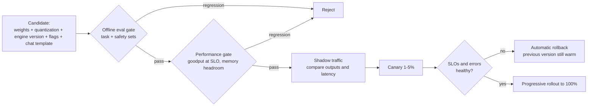
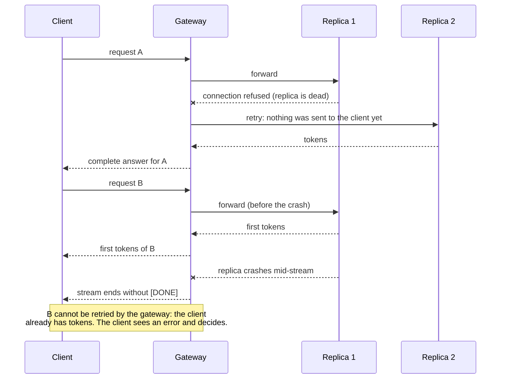

# Level 14: Production operations

> Serving one model to one load test is a project. Running it for a year (upgrades, failures, cost reviews, many tenants) is a platform.

**You will:** choose between EKS, SageMaker and APIs using numbers; ship model changes safely; design for GPU failure modes; run a chaos drill; secure the stack; and run offline batch inference cheaply.
**Time:** 4–6 hours · **Hardware:** laptop for the labs; your level 12/13 deployments for the stretch goals

---

## 1. Choosing a platform with numbers

```bash
python3 levels/14-production-operations/labs/cost_compare.py --tokens-per-day 200e6 --peak-to-avg 3 \
  --replica-tok-s 2500 --eks-instance-hour <price> --sm-instance-hour <price> --api-per-mtok <price>
```

Sample output (illustrative inputs; use your measured goodput and current prices):

```
option                   $/month  $/1M tok  notes
EKS + vLLM                 2,644     0.435  peak 4 replicas, avg 2.8
SageMaker + vLLM           2,947     0.485  peak 4 replicas, avg 3.0
Token-priced API           3,040     0.500  no capacity to manage
EKS becomes cheaper than the API above ~174M output tokens/day (with these inputs).
```

The structural lessons are more durable than the specific numbers:
- **Self-hosting is a fixed cost sized for peak.** APIs are a variable cost. Low or spiky volume favors APIs; high, steady volume favors self-hosting.
- **`replica-tok-s` is the most important input.** That's goodput *at your SLO* (level 9), not the marketing tokens/s. A 2× improvement from routing, quantization or batching (levels 7 and 10) halves the self-hosted cost.
- **Engineer time** isn't in the table, and it dominates at small scale.

## 2. Shipping model changes safely

A "model change" is any of: new weights, new quantization, new engine version, new flags, new chat template. Each one can change quality, latency or memory.

1. **Offline eval gate:** run your task-specific eval set (plus a safety set) on the candidate. Block on regressions beyond a threshold.
2. **Performance gate:** run the level 9 sweep. Block if goodput at SLO drops or memory headroom shrinks.
3. **Shadow traffic:** mirror a sample of production requests to the candidate and compare outputs and latency without serving them.
4. **Canary:** route 1–5% of traffic (by tenant or by hash) to the new version. Watch SLOs, error rates and user feedback.
5. **Progressive rollout, with automatic rollback** on SLO burn.
6. Keep the previous version **warm** until the new one has seen peak traffic.

Version everything together: `model revision + quantization + engine version + flags + chat template`. A "model" in your registry is that whole tuple.



## 3. Failure modes and what to do about them

| Failure | Symptom | Detection | Mitigation |
|---|---|---|---|
| GPU hardware fault (Xid 48/79, ECC) | pod crash, CUDA errors, NaNs | DCGM Xid/ECC metrics, node events | cordon and drain node; replace instance; N+1 capacity |
| GPU OOM | engine crash on long prompts | crash loops, logs | correct `max-model-len`, admission limits, gateway max-tokens caps |
| KV pressure / preemption | latency spikes, throughput collapse | `kv_cache_usage_perc` near 1, preemption counters | scale on KV usage; FP8 KV; route long context separately |
| Stuck / very long requests | slots held for minutes | e2e latency tail, running count without tokens | server-side max_tokens and timeouts; cancellation on disconnect (gateway) |
| NCCL hang (TP/multi-node) | engine alive but no output | liveness probe that **generates a token**, not just `/health` | restart the group together (LWS); check EFA/NCCL config |
| Replica death mid-stream | truncated responses | client error counters (streams without `[DONE]`) | retry only **before** the first byte; clients retry idempotent requests |
| Cold-start storm | many pods loading at once, TTFT burn | pods Pending/not Ready, queue depth | warm headroom, slower scale-in, faster loading |
| Capacity unavailable | pods Pending, NodeClaims failing | Pending duration alert | multiple instance types/AZs; reservations; spill to another region/provider |
| Spot interruption | 2-minute notice, node drained | interruption events | stateless replicas, N+1, drain gracefully, mix on-demand baseline |

**Health checks that test generation:** `/health` says the process is up. A synthetic probe that asks for 1 token every 30 s tells you the GPU path works. Run it from outside the pod (a blackbox exporter or a canary job) and alert on it.

What a client sees when a replica dies, depending on timing:



## 4. Security

- **Model supply chain:** load **safetensors** only. Pickle-based checkpoints can execute code when loaded. Pin model revisions (commit hashes) and mirror approved models to your own S3.
- **`trust_remote_code`:** some models ship custom Python. Enabling it runs that code in your pod. Review it, or avoid such models.
- **Tenant isolation:** API keys per tenant, token budgets (the gateway), per-tenant metrics and logs. Never put one tenant's data in another tenant's prefix-cache-visible prompts. Separate pools or MIG for strict isolation.
- **Network:** private subnets, internal load balancers, NetworkPolicies so only the gateway reaches vLLM pods. vLLM has no auth of its own, or only a simple `--api-key`.
- **Prompt injection, data leakage and content safety** are application-layer concerns (guardrails, input/output filters, tool sandboxing). The platform's job is to give the application hooks (pre/post-processing in the gateway) and audit logs.
- **Logging:** prompts and outputs may contain personal data. Decide retention deliberately, and redact before sending to shared logging.

## 5. Offline and batch inference

Evals, labeling, embeddings, synthetic data. There's no latency SLO, only throughput, cost and completion:
- Use the engine's **offline API** (level 8's `offline_batch.py`) or a batch job against a dedicated server at high `max-num-seqs`.
- Run on **Spot** or idle reserved capacity; **checkpoint progress** (write results per shard to S3, resume from the last completed shard).
- Sort or bucket prompts by length and share prefixes, which gives better batching and cache hits.
- Managed alternatives: SageMaker batch transform, provider batch APIs (often discounted for 24-hour turnaround).

## 6. Labs

```bash
cd levels/14-production-operations/labs
python3 cost_compare.py                     # then rerun with YOUR measured goodput and prices
./chaos.sh                                  # kill a replica mid-load on the laptop fleet
```

Sample `chaos.sh` result:

```
== Drill: kill replica-2 five seconds into the run
   [chaos] replica-2 killed at t=5s
Requests: 120  errors: 1  wall: 17.7s
SLO (TTFT<=500ms, TPOT<=50ms): 119/120 met (99.2%)  goodput 6.74 req/s
Backends: replica-1=58 replica-2=10 replica-3=51
```

One stream that was in flight on replica-2 was **truncated**. The load generator counts that as an error, not a fast success. New requests failed over within one health-check interval (and the gateway's pre-first-byte retry hid even the ones that were sent to the dead replica).

Assignments:
1. **Runbook:** answer the four questions `chaos.sh` prints. Write a one-page runbook for "replica died" and one for "GPU Xid error on a node".
2. **N+1 capacity:** rerun `chaos.sh` at a rate near the fleet's knee (level 9). Does losing one replica break the SLO? What `minReplicaCount` follows from that?
3. **Rollout design:** write the pipeline (gates, canary %, rollback triggers) for moving the production model from BF16 to FP8 weights.
4. **Stretch (EKS):** inject a failure in your level 12 cluster: delete a GPU node with `kubectl delete node` plus terminate the instance. Time detection → replacement → SLO recovery on your dashboard.

## 7. Check yourself

<details><summary>1. Why shouldn't the gateway retry a request after streaming has started?</summary>
The client has already received tokens. A retry would duplicate or contradict output. Only retry before the first byte; afterwards, surface the error and let the client decide.</details>

<details><summary>2. Your liveness probe hits /health and passes, yet the replica produces no tokens. What kind of probe catches this?</summary>
A synthetic generation probe (request 1 token with a short timeout) that exercises the scheduler and the GPU path. Alert on it rather than restarting aggressively.</details>

<details><summary>3. At what point does self-hosting beat a per-token API, structurally?</summary>
When steady volume keeps provisioned GPUs well utilized at your SLO, so the fixed instance cost per token falls below the API price including your operations overhead. Spiky or low volume pushes the break-even far out.</details>

## 8. Going deeper
- Google SRE book: SLOs, error budgets, alerting on burn rate
- NVIDIA DCGM docs (Xid errors, health checks); EKS node health monitoring / auto repair
- OWASP Top 10 for LLM Applications (application-layer risks)
- Hugging Face docs on safetensors and `trust_remote_code`

**Next → [Level 15: Capstone and system design](../15-capstone-and-system-design/README.md)**
