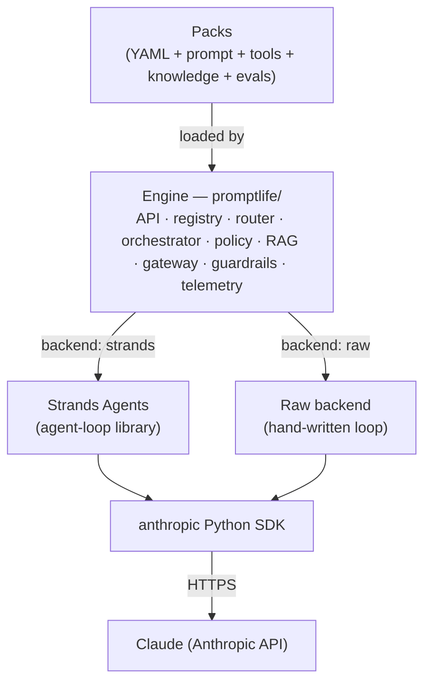
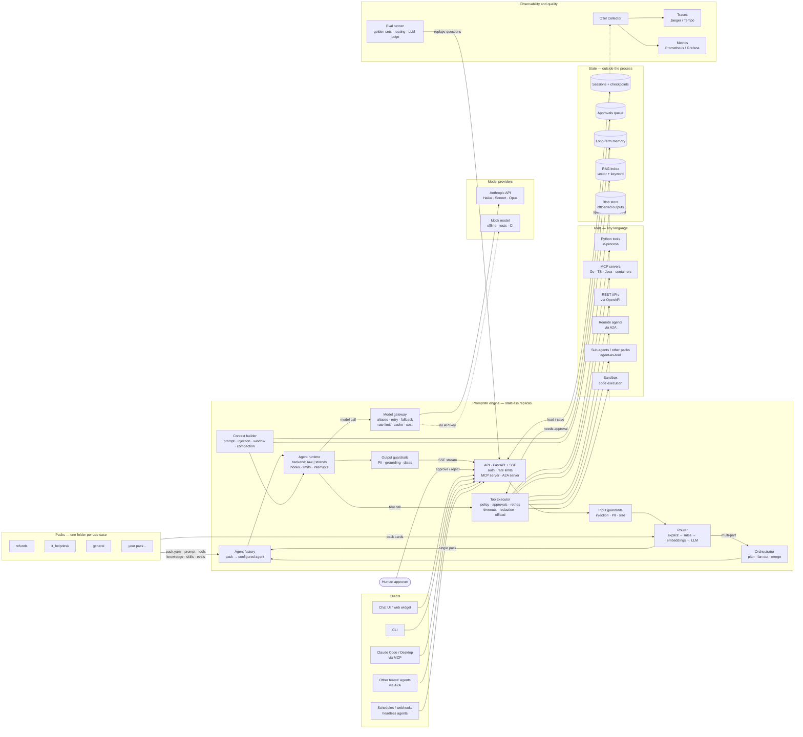

# Promptlife

A production-style, **pack-based LLM agent platform** built to learn every layer of
[The Life of a Prompt](https://claude.ai/artifact/46S95koQPmBi8CCCrS5Yqy): from the
moment a user hits Enter to the moment an answer streams back.

> **Status: design phase.** This folder currently holds the system design and a
> video explainer. Code comes next, following the [roadmap](docs/design/12-roadmap.md).

## The idea in one picture



- **Engine** — generic platform code we write once. It never mentions refunds or pods.
- **Packs** — one folder per use case (refunds, IT helpdesk, docs Q&A, ...). Adding a use
  case means adding a folder, not touching the engine.
- **Backends** — the same pack runs on a hand-written agent loop (to learn the mechanics)
  or on [Strands Agents](https://strandsagents.com/) (to learn what an SDK gives you).
- **Mock provider** — everything runs offline with no API key; set `ANTHROPIC_API_KEY`
  to use real Claude models.

## Holistic system diagram



**How to read it:** a request enters at the API and passes the input guardrails. The
router picks a pack, or the orchestrator if the question spans several packs. The agent
factory builds that pack's agent, and the runtime loops between the **model gateway**
(which model) and the **ToolExecutor** (which tool, under which policy) until the
answer is ready. The answer then streams back through the output guardrails. All state
lives outside the process, and every hop is traced.

## Video explainer

[`video/`](video/) holds a 3-minute, 3Blue1Brown-style explainer
([`life-of-a-prompt.mp4`](video/life-of-a-prompt.mp4)) that follows one question through
the loop, context window, packs, routing, gateway, policy and the whole system. Open
`video/explainer.html` in a browser to watch it live, or re-render with
`node video/render.mjs` (needs Playwright and ffmpeg).

## Design documents

| # | Document | What it answers |
|---|---|---|
| 00 | [Overview](docs/design/00-overview.md) | Goals, non-goals, requirements, chapter → component map |
| 01 | [Architecture](docs/design/01-architecture.md) | Components, request flow, data stores, sequence diagram |
| 02 | [Packs](docs/design/02-packs.md) | The pack format and its full manifest schema |
| 03 | [Routing & orchestration](docs/design/03-routing-and-orchestration.md) | Who handles a question, and how multi-step work is coordinated |
| 04 | [Model gateway](docs/design/04-model-gateway.md) | Model aliases, providers, fallback, escalation, caching, cost |
| 05 | [Agent runtime](docs/design/05-agent-runtime.md) | The loop, backends, hooks, state, sessions, interrupts |
| 06 | [Tools & policy](docs/design/06-tools-and-policy.md) | Python / MCP / OpenAPI / agent tools, approvals, sandbox, skills |
| 07 | [Context, memory & RAG](docs/design/07-context-memory-rag.md) | What the model sees and how it remembers |
| 08 | [Safety](docs/design/08-safety.md) | Guardrails, PII, prompt injection, threat model |
| 09 | [Observability & evals](docs/design/09-observability-and-evals.md) | Traces, metrics, cost, golden datasets, LLM judge |
| 10 | [Deployment](docs/design/10-deployment.md) | Docker Compose locally, Kubernetes in production |
| 11 | [HTTP API](docs/design/11-api.md) | The public API contract |
| 12 | [Roadmap](docs/design/12-roadmap.md) | Build order (v1 → v3) and why each piece is added when it is |
| 13 | [Polyglot packs](docs/design/13-polyglot-packs.md) | Tools in any language, per-pack MCP and skills, human languages |
| 14 | [Interop: MCP and A2A](docs/design/14-interop-mcp-a2a.md) | When to use MCP vs A2A vs in-process agents |

Extension guides (written against the design; they become runnable as code lands):

- [Adding a pack](docs/guides/adding-a-pack.md)
- [Adding tools (Python, MCP, OpenAPI)](docs/guides/adding-tools.md)
- [Adding agents and multi-agent flows](docs/guides/adding-agents.md)
- [Extending the engine (providers, backends, router stages, guardrails)](docs/guides/extending-the-engine.md)

Architecture decision records live in [docs/adr](docs/adr/).

## Planned code layout

```
promptlife/            the engine (Python package)
  api/                 HTTP API (FastAPI, SSE streaming)
  packs/               pack schema, registry, loader
  routing/             rules → embeddings → LLM router
  orchestration/       workflow, orchestrator-workers, handoff, graph
  backends/            raw loop, Strands adapter
  tools/               tool sources + the ToolExecutor (policy, retries, offloading)
  policy/              rules engine, approvals store
  context/             prompt rendering, injection, compaction
  memory/  rag/        long-term memory, chunking, hybrid search
  gateway/             model aliases, providers (anthropic, mock), fallback, cost
  safety/              input/output guardrails
  telemetry/           OpenTelemetry spans and metrics
  evals/               eval runner, judges
packs/
  refunds/             Maya's refund assistant (from The Life of a Prompt)
  it_helpdesk/         DevOps helpdesk: service health, logs, restarts
  general/             fallback pack for unroutable questions
deploy/                Dockerfile, docker-compose, Kubernetes manifests
docs/                  this design
tests/
```
