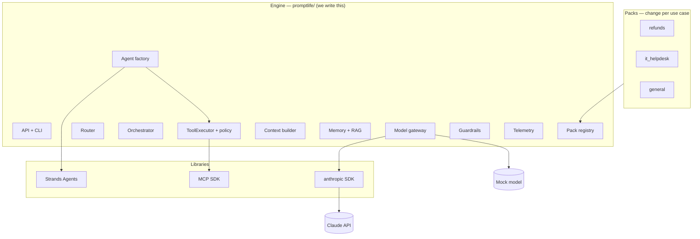
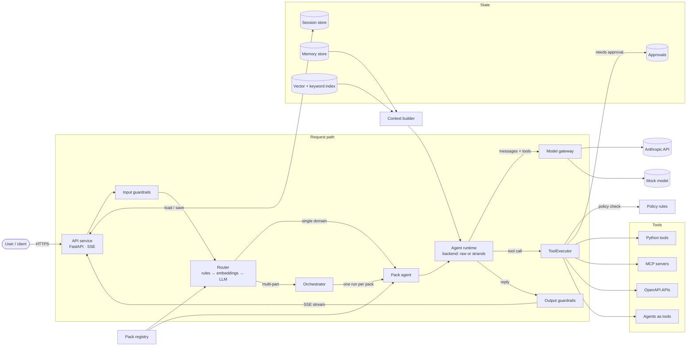
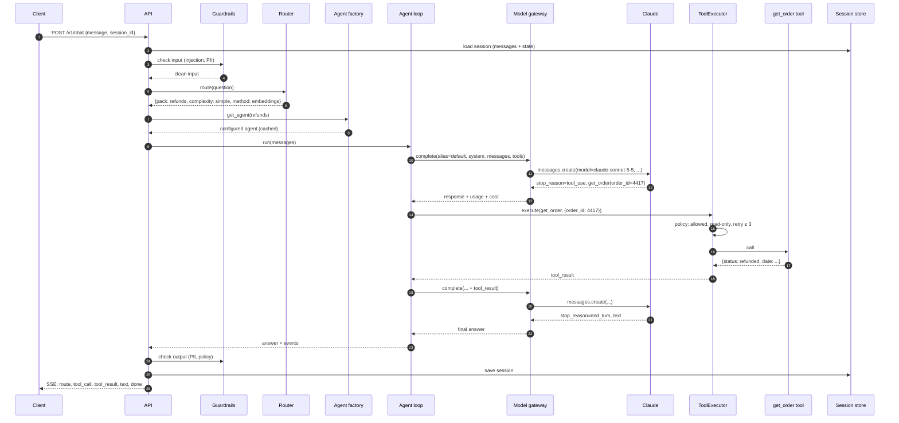

# 01 · Architecture

## Layers

Analogy for platform engineers: **packs are Deployments** (a declarative spec), **the
engine is Kubernetes** (reads specs, wires config, secrets, policy, observability), and
**Strands / the raw loop is the container runtime** (actually runs the workload).

## Component view

## One request, end to end

Maya asks *"Where's my refund for order #4417?"*

Every arrow above is also an OpenTelemetry span (see [09](09-observability-and-evals.md)).

## Engine modules and their contracts

| Module | Responsibility | Key interface |
|---|---|---|
| `packs.registry` | Discover, validate, hot-reload packs | `Registry.get(name) -> Pack`, `Registry.cards() -> list[PackCard]` |
| `packs.factory` | Turn a `Pack` into a runnable agent | `AgentFactory.build(pack, backend) -> Agent` |
| `routing.router` | Pick pack + complexity | `Router.route(question, session) -> Route` |
| `orchestration` | Plan, fan out, merge | `Orchestrator.run(question, route) -> Answer` |
| `backends` | Run the agent loop | `Backend.run(agent_spec, messages, events) -> RunResult` |
| `tools.executor` | Every tool call goes through here | `ToolExecutor.call(tool, input, ctx) -> ToolResult` |
| `policy` | Allow / deny / needs approval / retry class | `Policy.evaluate(tool, input, ctx) -> Decision` |
| `context` | Build system prompt and message window | `ContextBuilder.build(pack, session, question) -> Context` |
| `memory`, `rag` | Long-term facts, retrieval | `Memory.read/write`, `Retriever.search(query, k)` |
| `gateway` | Model calls with alias resolution, retries, fallback, cost | `Gateway.complete(alias, request) -> ModelResponse` |
| `safety` | Input and output checks | `Guardrails.check_input/check_output` |
| `telemetry` | Spans, metrics, cost | `span(name, **attrs)`, `metrics.record(...)` |

All interfaces use the Anthropic Messages content-block shape (`text`, `tool_use`,
`tool_result`) as the internal message format. It is the format the raw loop speaks
natively, and the mock provider emits the same blocks.

## Data stores

| Store | Holds | Local | Production |
|---|---|---|---|
| Sessions | messages (append-only), agent state, checkpoint | SQLite | Postgres |
| Approvals | pending tool calls awaiting a human | SQLite | Postgres |
| Memory | long-term facts per user per pack | SQLite | Postgres |
| RAG index | chunks, embeddings, keyword index | SQLite + in-process index | Postgres + pgvector |
| Offloaded blobs | large tool outputs | `./data/blobs` | object storage (S3/R2) |
| Traces | spans | Jaeger (Compose) | OTel Collector → Jaeger/Tempo |

## Failure modes and responses

| Failure | Response |
|---|---|
| Model 429 / 5xx | Gateway retries with backoff, then falls back to the alias's fallback model |
| Model refusal (`stop_reason: refusal`) | Server-side fallback when enabled; otherwise a safe message and a `refusal` event |
| Tool timeout (read-only) | Retry up to the pack's `read_only` budget |
| Tool timeout (side effect) | Never retried; surfaced to the agent as an error result |
| Loop runs too long | `max_turns` stops it; optional escalation to the `deep` alias |
| Replica dies mid-run | Session checkpoint lets any replica resume |
| Approval needed | Run pauses with an `interrupt`; resumes on approve/reject |
