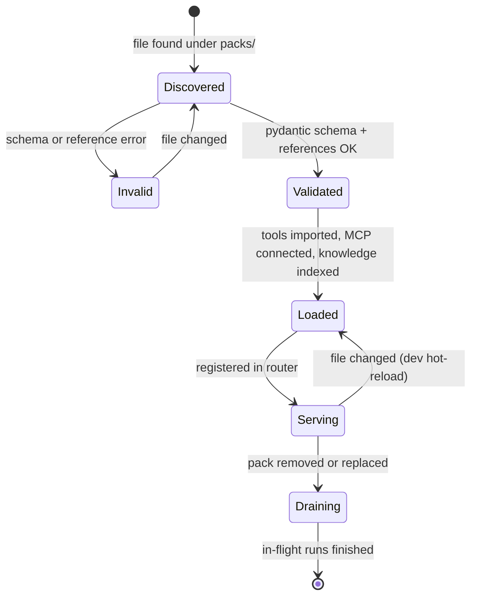

# 02 · Packs

A **pack** is everything that makes the engine do one job. The engine reads packs; it
never imports domain code directly.

## Layout

```
packs/refunds/
  pack.yaml          manifest (required)
  prompt.md          system prompt template (required)
  tools.py           Python tools decorated with @tool (optional)
  knowledge/         documents indexed for RAG (optional)
  skills/            SKILL.md folders loaded on demand (optional)
  evals.jsonl        golden dataset (strongly recommended)
  fixtures/          seed data for local dev and tests (optional)
```

## Manifest

```yaml
# packs/refunds/pack.yaml
apiVersion: promptlife/v1
name: refunds
version: 1.2.0
description: Order status, returns, refunds and shipping delays for Acme customers.
examples:                         # used by the embedding router and the LLM router
  - where is my refund
  - I returned my desk, when do I get my money back
  - my package never arrived

model:
  alias: default                  # fast | default | deep — resolved by the gateway
  escalate_to: deep               # used when the route or the run says "hard"
  effort: medium                  # optional; omitted for models that don't take it
  max_tokens: 16000

backend: strands                  # raw | strands (overridable per request in dev)

prompt:
  template: prompt.md
  variables:                      # filled at build time
    company: Acme
    region: EU
  inject: [current_date, user_tier]   # context injection, filled per request

tools:
  - python: tools.py
  - mcp:
      name: carrier
      command: python
      args: [-m, carrier_mcp]
      env: { CARRIER_API_KEY: ${CARRIER_API_KEY} }
  - openapi:
      spec: https://api.example-carrier.com/openapi.json
      operations: [getTracking]
      auth: { header: X-API-Key, secret: CARRIER_API_KEY }
  - agent: shipping_specialist    # another pack used as a tool

knowledge:
  path: knowledge/
  chunking: { strategy: markdown_headings, max_tokens: 400, overlap: 40 }
  search: hybrid                  # keyword | vector | hybrid
  top_k: 4

skills:
  path: skills/                   # only names + one-line summaries enter context

memory:
  long_term: true
  kinds: [semantic, episodic]

policies:
  require_approval: [issue_refund]
  deny:
    - tool: issue_refund
      when: input.amount > 500
      message: Refunds over $500 must go through finance.
  retry:
    read_only: 3
    side_effect: 0
  side_effect_tools: [issue_refund, cancel_order]
  timeouts_s: { default: 10, issue_refund: 30 }

limits:
  max_turns: 12                   # loop iterations
  max_tool_calls: 20
  max_cost_usd: 0.50              # per request

guardrails:
  input: [prompt_injection, pii_redact]
  output: [pii_redact, no_unverified_dates]

agents:                           # optional multi-agent inside the pack
  shipping_specialist:
    description: Carrier tracking and delivery problems.
    prompt: prompts/shipping.md
    model: { alias: fast }
    tools: [get_carrier_status]

evals:
  dataset: evals.jsonl
  judges: [correctness, tone, policy]
```

### Rules

- `name` is unique and matches the folder name.
- Secrets are **never** inline. `${VAR}` and `secret:` refer to environment variables;
  the registry fails validation if a referenced secret is missing in production mode.
- `model.alias` must exist in `engine.yaml`; packs never hard-code model IDs.
- Tool names are unique within a pack after all sources are loaded; MCP tools are
  prefixed with the server name (`carrier__track`) to avoid collisions.
- `version` follows semver. The version is stamped on every trace and session so
  evals and incidents can be tied to an exact pack version.

## Lifecycle



- **Validation** happens at startup and in CI (`promptlife packs validate`).
- **Loading** is lazy for expensive parts: MCP servers connect on first use; knowledge
  indexes are built at startup but cached on disk by content hash.
- **Hot-reload** is dev-only. In production, packs ship inside the image or a ConfigMap
  and change via a normal rollout.

## The pack card

The router never sees a pack's tools or prompt. It sees only the **card**:

```json
{"name": "refunds",
 "description": "Order status, returns, refunds and shipping delays for Acme customers.",
 "examples": ["where is my refund", "..."]}
```

That keeps routing cheap and makes every new pack routable automatically
(progressive disclosure, chapter 02).

## Example packs

| Pack | Purpose | Shows |
|---|---|---|
| `refunds` | Maya's story from *The Life of a Prompt* | side-effect tools, approvals, deny rule, RAG over policy |
| `it_helpdesk` | DevOps helpdesk: service health, logs, restart a deployment | MCP + OpenAPI tools, K8s-style actions behind approval, runbook RAG |
| `general` | Fallback when routing confidence is low | no tools, asks clarifying questions |

See [Adding a pack](../guides/adding-a-pack.md) for the step-by-step guide.
