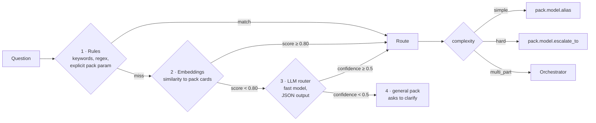
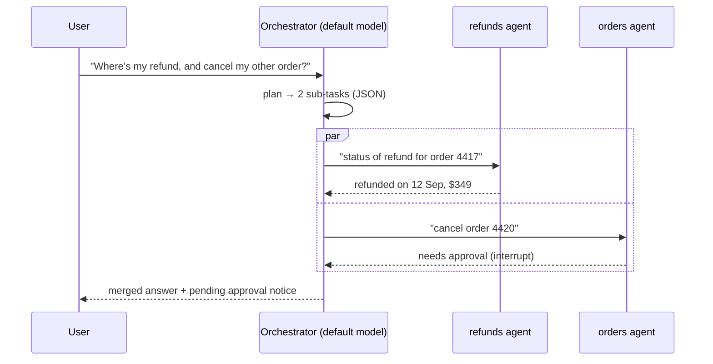

# 03 · Routing and orchestration

- **Routing** decides *who* handles a question. One decision at the entrance.
- **Orchestration** decides *how* work gets done when it needs several steps or agents.

Infrastructure analogy: routing is an L7 ingress picking a backend; orchestration is a
workflow engine (Temporal, Argo Workflows) coordinating steps.

## Routing



### The route object

```python
class Route(BaseModel):
    pack: str                       # one of the registered pack names
    complexity: Literal["simple", "hard", "multi_part"]
    confidence: float               # 0..1
    method: Literal["explicit", "rules", "embeddings", "llm", "fallback"]
    reason: str
    sub_questions: list[str] = []   # filled when complexity == multi_part
```

### Stage details

| Stage | Cost / latency | Good at | Weak at |
|---|---|---|---|
| Explicit (`pack` in request, sticky session pack) | free | follow-up turns in the same domain | first turn |
| Rules | ~0 ms | IDs, product names, hard business rules | paraphrases |
| Embeddings | ~10–30 ms | paraphrases of the pack examples | multi-part or unusual phrasing |
| LLM router | ~300–600 ms, cheapest model | ambiguity, multi-part detection, complexity | cost at very high volume |

- **Sticky routing**: once a session is on a pack, follow-up turns stay there unless the
  router's rules or embeddings point clearly elsewhere (score ≥ 0.90). This avoids a
  router call on every turn.
- **LLM router output** uses structured outputs (`output_config.format` with a JSON
  schema), not forced tool use. Current models reject forced `tool_choice`.
- **Cards only**: the LLM router prompt contains the pack cards, not tools or prompts.
- **Deterministic calls are cached** by the gateway (same question + same card set →
  same route) for a short TTL.

### Model selection after routing

```python
alias = {
    "simple": pack.model.alias,
    "hard": pack.model.escalate_to or pack.model.alias,
}[route.complexity]
```

Two runtime safety nets on top:

- **Escalation** — if a run hits `max_turns`, repeats a failing tool, or a self-check
  fails, the engine re-runs once on `escalate_to`.
- **Fallback** — on 429/5xx/refusal, the gateway switches models (see [04](04-model-gateway.md)).

### Measuring routing

Every route is a span with `route.pack`, `route.method`, `route.confidence`. The eval
suite includes a routing dataset (`question → expected pack`) and reports accuracy,
per-stage hit rate, and cost per routed question. Thresholds (0.80, 0.5) are tuned
from that report, not guessed.

## Orchestration patterns

| Pattern | Who decides the steps | Used for | Module |
|---|---|---|---|
| Workflow | engine code, fixed order | the request pipeline itself | `orchestration/workflow.py` |
| Orchestrator-workers | an LLM at runtime | multi-part questions across packs | `orchestration/orchestrator.py` |
| Handoff (swarm) | each agent passes control | triage → specialist inside a pack | `orchestration/handoff.py` |
| Graph | code-defined nodes, LLM-chosen edges | approval flows: draft → approve → execute | `orchestration/graph.py` |
| Agent as tool | parent agent calls child like a function | specialist help without giving up control | `tools/agent_tool.py` |

### Orchestrator-workers



Rules:

- The plan is structured output: `[{pack, sub_question, depends_on}]`. Independent tasks
  run in parallel (bounded concurrency); dependent tasks run in order.
- Each worker run is a normal pack run, with its own policy, limits and spans
  (`parent_span_id` links them).
- If any worker raises an interrupt (approval), the orchestrator returns the partial
  answer plus the pending item; the session records which sub-task is waiting.
- A per-request cost cap applies to the whole fan-out.

### When not to orchestrate

Start with one agent with good tools. Add routing when packs diverge. Add the
orchestrator only when real traffic shows multi-domain questions. The router's
`multi_part` rate (a metric) tells you when.
