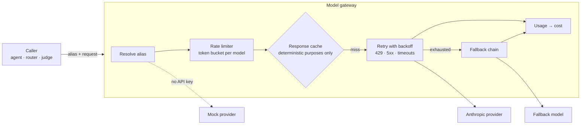

# 04 · Model gateway

Every model call in the engine goes through the gateway. Packs and engine code ask for
an **alias**; the gateway decides the concrete model and provider.



## Configuration

```yaml
# engine.yaml
models:
  fast:
    provider: anthropic
    id: claude-haiku-4-5
  default:
    provider: anthropic
    id: claude-sonnet-5-5
    effort: medium
    fallback: fast
  deep:
    provider: anthropic
    id: claude-opus-5-5
    effort: high
    fallback: default
  mock:
    provider: mock

roles:                 # engine-internal jobs → alias
  router: fast
  compaction: fast
  guardrail: fast
  planner: default
  judge: deep

provider_mode: auto    # auto: use mock when ANTHROPIC_API_KEY is unset
                       # live: fail if the key is missing
                       # mock: always mock (tests, CI)

pricing_usd_per_mtok:  # verify against current pricing before relying on cost numbers
  claude-haiku-4-5:  { input: 1.00, output: 5.00 }
  claude-sonnet-5-5: { input: 2.00, output: 10.00, cache_read: 0.20 }
  claude-opus-5-5:   { input: 4.00, output: 20.00, cache_read: 0.20 }

gateway:
  retries: 3
  backoff: { base_s: 1.0, max_s: 20.0, jitter: true }
  timeout_s: 120
  rate_limits: { claude-sonnet-5-5: { rpm: 50 } }
  response_cache: { purposes: [router], ttl_s: 300 }
  server_side_fallbacks: true     # Anthropic refusal fallback, see below
```

Changing a model for the whole platform is a one-line change to `engine.yaml`, the way
a Service name decouples clients from pods.

## Provider interface

```python
class Provider(Protocol):
    name: str
    def available(self) -> bool: ...
    def complete(self, req: ModelRequest, on_text: Callable[[str], None] | None = None) -> ModelResponse: ...
    def count_tokens(self, req: ModelRequest) -> int: ...
```

`ModelRequest` / `ModelResponse` use Messages API content blocks. Providers:

| Provider | Notes |
|---|---|
| `anthropic` | Official `anthropic` Python SDK. Non-streaming `messages.create` by default; `messages.stream(...)` + `get_final_message()` when the caller streams text. SDK retries disabled (`max_retries=0`) so the gateway owns retry policy and can count attempts. |
| `mock` | Deterministic. Picks tools by keyword overlap with the question, extracts arguments with patterns, answers from tool results. Supports scripted responses for tests. Returns realistic `usage` so cost code is exercised. |

Adding Bedrock, Vertex or another vendor is one class (see
[Extending the engine](../guides/extending-the-engine.md)).

## Claude API specifics the provider must respect

These come from the current Claude API docs and shape the provider design:

- **Model IDs**: `claude-opus-5-5`, `claude-sonnet-5-5`, `claude-haiku-4-5`. Exact strings, no date suffix.
- **No sampling params** (`temperature`, `top_p`) on Opus 5.5 / Sonnet 5.5; non-default values return 400. The provider never sends them.
- **Thinking**: omit the `thinking` parameter (adaptive by default on Opus 5.5 and Sonnet 5.5). Depth is controlled with `output_config.effort`. Opus 5.5 defaults to `medium`, so the config sets effort explicitly. Haiku 4.5 does not accept `effort`, so it is only sent when the alias sets it.
- **No forced tool choice** (`tool_choice: any|tool`) on Opus 5.5 / Sonnet 5.5. The router and planner use **structured outputs** (`output_config.format` with a JSON schema) instead.
- **Append-only history**: assistant `content` (including thinking blocks) is appended back unchanged. The session store never edits earlier turns; compaction appends a summary instead of rewriting (see [07](07-context-memory-rag.md)).
- **Stop reasons**: handle `end_turn`, `tool_use`, `max_tokens`, `pause_turn`, and `refusal` (check before reading content).
- **Refusal fallback**: with `server_side_fallbacks: true`, requests to Opus 5.5 / Sonnet 5.5 use the beta `fallbacks: "default"` parameter (header `server-side-fallback-2026-07-01`) so a declined request is re-run on a suitable model server-side.
- **Parallel tool calls**: all `tool_result` blocks for one assistant turn go back in a single user message; failures use `is_error: true`.
- **Prompt caching**: top-level `cache_control: {type: "ephemeral"}`. Render order is tools → system → messages, so the system prompt and tool list must be byte-stable (no timestamps; tools sorted by name). Volatile context (date, user tier) is injected after the cached prefix.
- **Errors**: `RateLimitError`, `APIStatusError` ≥ 500, `APIConnectionError`, `APITimeoutError` are retryable; other 4xx are not.

## Retry, fallback and escalation

| Mechanism | Trigger | Scope | Owner |
|---|---|---|---|
| Retry | 429, 5xx, timeout, connection error | same model | gateway |
| Fallback | retries exhausted; model unavailable | next model in `fallback` chain | gateway |
| Server-side fallback | refusal on supported models | Anthropic picks the model | API |
| Escalation | hard route, max turns hit, failed self-check | `escalate_to` alias, whole run | engine |

## Cost accounting

`cost = input × p_in + output × p_out + cache_read × p_cache_read + cache_write × p_cache_write`

Recorded per call as span attributes and aggregated per request, session, pack, model
and route method. `limits.max_cost_usd` on a pack stops a run that would exceed it.
