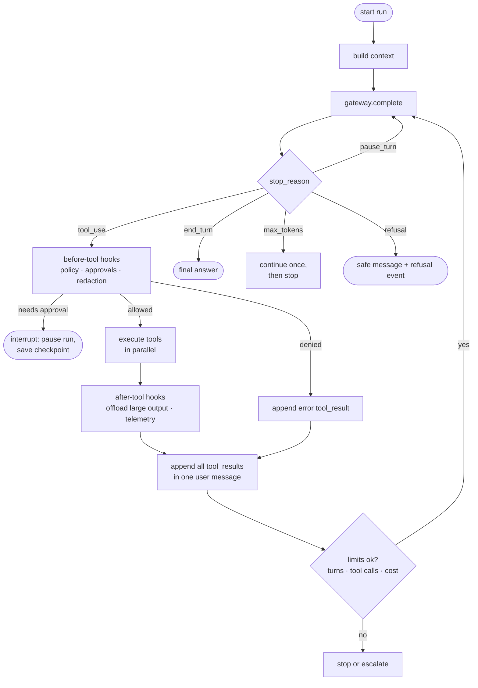
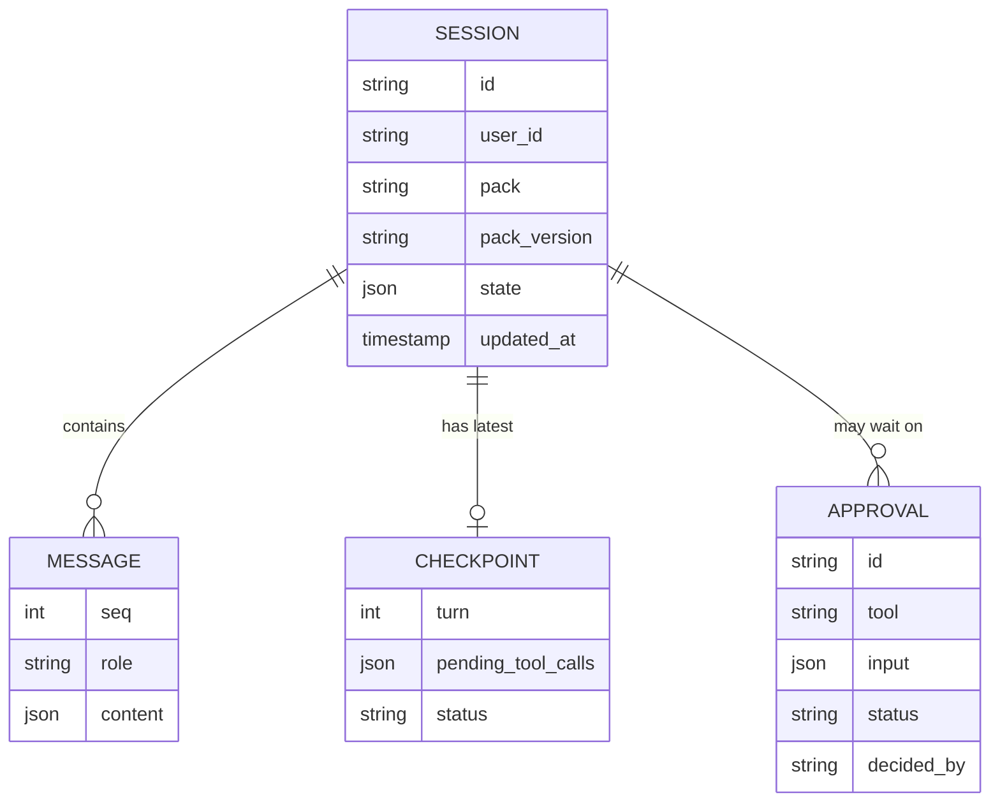

# 05 · Agent runtime

## The loop

Every backend implements the same loop. The raw backend writes it out; Strands runs it
for us.



## Backend interface

```python
class Backend(Protocol):
    name: str  # "raw" | "strands"
    def run(self, spec: AgentSpec, session: Session, events: EventSink) -> RunResult: ...
    def resume(self, spec: AgentSpec, session: Session, decision: ApprovalDecision,
               events: EventSink) -> RunResult: ...
```

`AgentSpec` is what the factory builds from a pack: system prompt, tool definitions
(already wrapped by the `ToolExecutor`), model alias, limits, hooks.

| | `raw` | `strands` |
|---|---|---|
| Loop | ~100 lines in `backends/raw.py` | `strands.Agent` |
| Model calls | `gateway.complete(...)` | a small Strands model adapter that calls the gateway |
| Tools | `ToolExecutor` directly | each engine tool wrapped as a Strands tool whose body calls the `ToolExecutor` |
| Conversation window | engine `ContextBuilder` | Strands conversation manager, configured from the pack |
| Hooks | engine hook list | engine hooks + Strands hook providers |
| Purpose | learn the mechanics; zero dependencies | learn the SDK; multi-agent (swarm, graph), built-in tracing |

**Why tools go through the `ToolExecutor` in both backends:** policy, approvals, retries,
offloading and telemetry must behave identically whatever the backend. The backend is
a replaceable loop, not a security boundary (see [ADR-0004](../adr/0004-policy-at-the-tool-boundary.md)).

## Hooks

| Hook point | Examples |
|---|---|
| `before_model_call` | inject context, enforce cost cap |
| `after_model_call` | record usage and cost, detect refusal |
| `before_tool_call` | policy decision, approval interrupt, argument validation |
| `after_tool_call` | redact PII in output, offload large results, metrics |
| `on_run_end` | save session, emit summary span |

Hooks are engine objects registered by the factory. Packs enable built-ins in YAML;
custom hooks are Python classes referenced by import path (see the guides).

## State, sessions and checkpoints



- **Messages** are append-only and stored exactly as sent to and received from the model.
- **Agent state** (`customer_id`, `current_order`, `approved`) lives next to the
  messages, not inside them, so it costs no context tokens.
- **Checkpoint** is written after every completed tool round. A crash or a redeploy
  resumes from the last checkpoint on any replica.
- **Interrupt**: an approval-required call saves a checkpoint with
  `status=awaiting_approval` and returns an `interrupt` event. `POST /v1/approvals/{id}`
  resumes the run with the decision.

## Limits

| Limit | Default | Behavior when hit |
|---|---|---|
| `max_turns` | 12 | stop with a partial answer, or escalate once |
| `max_tool_calls` | 20 | same |
| `max_cost_usd` | 0.50 | stop before the next model call |
| tool `timeout_s` | 10 | error result to the model; retry if read-only |
