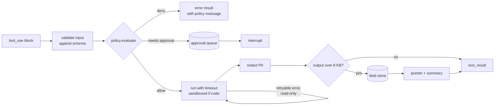
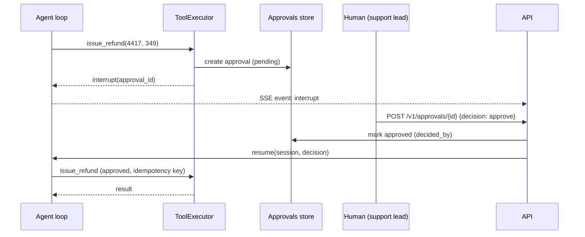

# 06 · Tools and policy

## Tool sources

All sources produce the same `Tool` object, so the model, the policy engine and the
telemetry treat them identically.

```python
@dataclass
class Tool:
    name: str                    # unique within the pack
    description: str
    input_schema: dict           # JSON Schema; strict where possible
    side_effect: bool            # from pack policies or the @tool decorator
    source: Literal["python", "mcp", "openapi", "agent", "a2a", "memory", "rag", "skill"]
    call: Callable[[dict, ToolContext], ToolOutput]
```

| Source | Declared as | How it becomes a `Tool` |
|---|---|---|
| Python | `- python: tools.py` | `@tool` functions; schema from type hints + docstring |
| MCP (stdio) | `- mcp: {command, args, env}` | MCP SDK client; `list_tools()`; names prefixed `server__tool` |
| MCP (HTTP) | `- mcp: {url, auth}` | streamable HTTP client; same as above |
| OpenAPI | `- openapi: {spec, operations, auth}` | each selected operation → one tool; httpx calls; auth from secrets |
| Agent | `- agent: <name>` | another agent (pack or sub-agent) wrapped as `ask_<name>(question)` |
| A2A | `- a2a: {card_url, skills}` | remote agent skills from its Agent Card (see [14](14-interop-mcp-a2a.md)) |
| Built-in | `memory`, `knowledge.search`, `skills.load` | engine-provided when the pack enables them |

```python
# packs/refunds/tools.py
from promptlife.tools import tool

@tool(side_effect=False)
def get_order(order_id: str) -> dict:
    """Look up an order by ID. Returns status, items, refund state and dates."""
    ...

@tool(side_effect=True)
def issue_refund(order_id: str, amount: float, reason: str) -> dict:
    """Issue a refund. Requires approval; never retried automatically."""
    ...
```

## The ToolExecutor

Every call from every backend goes through one function:



Every step is a span attribute: `tool.name`, `tool.source`, `policy.decision`,
`tool.attempts`, `tool.duration_ms`, `tool.offloaded`.

## Policy

Policies are **data in the pack, enforced by engine code**. They hold even if the model
ignores the prompt or the prompt is attacked.

| Rule | Example | Effect |
|---|---|---|
| `deny` | `tool: issue_refund, when: input.amount > 500` | call blocked, model gets the message |
| `require_approval` | `[issue_refund, restart_deployment]` | run pauses until a human decides |
| `side_effect_tools` | `[issue_refund]` | never auto-retried; idempotency key attached |
| `retry` | `read_only: 3, side_effect: 0` | retry budget per class |
| `timeouts_s` | `default: 10` | per tool |

`when` expressions use a small, safe expression language (comparison, boolean ops,
field access on `input`, `state`, `user`). No `eval`. A policy engine such as Cedar or
OPA can replace the built-in evaluator behind the same `Policy` interface.

Decision order: **deny → require_approval → allow**. Default for unknown tools is deny.

## Human approval



## Sandbox

Tools that run code or shell commands (`run_script`) execute in a sandbox:

- local: a subprocess with a temp directory, no network, CPU/memory/time limits;
- production: a separate container or gVisor/Firecracker micro-VM per run.

The sandbox is itself a tool source, so it inherits policy and telemetry.

## Skills

A skill is a folder with `SKILL.md` (frontmatter: `name`, `description`) plus optional
scripts. Only names and one-line descriptions go into the system prompt. The built-in
`skills.load(name)` tool returns the full instructions when the model asks for them
(progressive disclosure).

## Exposing a pack as an MCP server

`promptlife mcp serve --pack refunds` starts an MCP server that exposes one tool,
`ask_refunds(question)`, which runs the full pack (policy included). The same pack can
then be used from Claude Code, Claude Desktop or another agent.
