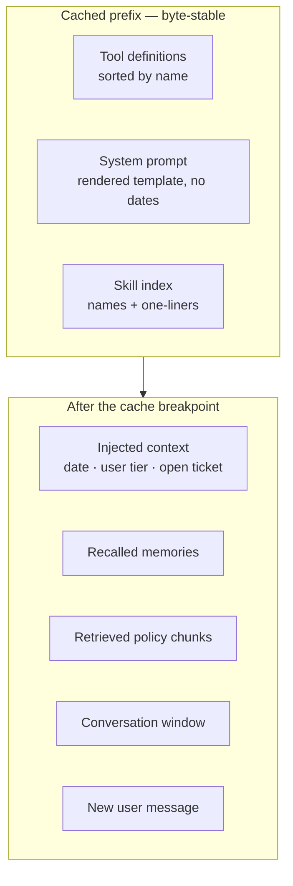
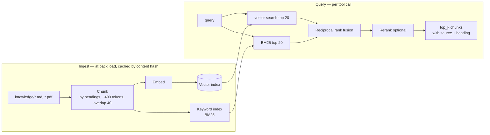

# 07 · Context, memory and RAG

## What the model sees on each call

The context builder assembles this per call. Ordering is chosen for prompt caching:
anything that changes per request comes after the stable prefix.

## Context engineering features

| Feature | Design |
|---|---|
| Prompt template | `prompt.md` with `{{ variables }}` rendered once per pack load |
| Context injection | `inject: [current_date, user_tier]` → providers registered in the engine; rendered into a context block in the first user turn of each request |
| Few-shot examples | `examples/` folder in the pack; appended to the system prompt |
| Conversation manager | `sliding_window` (default, last N turns) or `summarizing`; the Strands backend uses Strands' managers with the same settings |
| Compaction | when estimated tokens exceed `compaction.trigger_tokens`, the `compaction` role (fast model) summarizes older turns; the summary is **appended** as a new message, and the window starts after it, so history stays append-only |
| Context editing | tool results older than K turns are replaced in the *window* (not in storage) by a one-line stub |
| Context offloading | tool outputs over 8 KB go to the blob store; the model gets a pointer and a summary, plus a `blob.read(id, range)` tool |

## Memory

| Kind | Example | Stored as | Written by |
|---|---|---|---|
| Short-term | this conversation | session messages | engine |
| Semantic | "prefers email over SMS" | `memories(user, pack, kind, text, embedding)` | `memory.write` tool |
| Episodic | "returned a chair on 3 Aug" | same table, `kind=episodic` | `memory.write` tool or end-of-session summarizer |
| Procedural | "for EU orders, check VAT refund first" | pack skills / prompt | humans, via pack changes |

- The agent decides what to remember via the `memory.write` tool (chapter 05's memory tool).
- At the start of a request, the top-k relevant memories for this user and pack are recalled into context.
- Memories are scoped by `user_id` and pack; a pack can opt into shared memory.
- Users can list and delete their memories (`GET/DELETE /v1/memories`).

## RAG pipeline

- **Hybrid search** because questions contain exact strings (order numbers, error codes)
  that pure vector search misses.
- **Embedder interface** with two implementations: a local hashing embedder (offline,
  zero dependencies, good enough for tests) and an API embedder (e.g. Voyage AI) for
  production quality.
- **Retrieval is a tool** (`knowledge.search`) by default, so the model asks when it
  needs policy text. Packs can also set `knowledge.auto: true` to pre-retrieve for every
  question.
- **Citations**: every chunk carries `source` and `heading`; the prompt asks the model to
  cite them, and an output guardrail can check that cited sources exist.
- Production storage: Postgres + pgvector; the index interface hides the backend.
