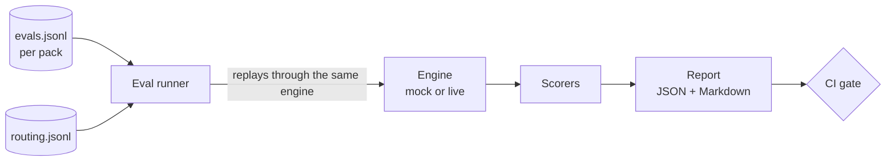

# 09 · Observability and evals

## Tracing

Every request produces one trace. Span names and attributes follow the OpenTelemetry
GenAI semantic conventions where they exist (`gen_ai.*`) plus `promptlife.*` attributes.

```mermaid
gantt
    dateFormat X
    axisFormat %L ms
    section request
    http POST /v1/chat            :0, 4200
    section pipeline
    guardrail.input               :20, 60
    route (embeddings)            :60, 90
    section agent run
    agent.run refunds             :90, 4100
    gen_ai.chat sonnet (turn 1)   :100, 1500
    tool get_order                :1500, 1700
    tool knowledge.search         :1500, 1650
    gen_ai.chat sonnet (turn 2)   :1700, 4000
    section post
    guardrail.output              :4100, 4150
    session.save                  :4150, 4200
```



| Span | Key attributes |
|---|---|
| `http.request` | `http.route`, `user.id` (hashed), `session.id` |
| `route` | `route.pack`, `route.method`, `route.confidence`, `route.complexity` |
| `agent.run` | `pack.name`, `pack.version`, `backend`, `turns`, `stop_reason` |
| `gen_ai.chat` | `gen_ai.request.model`, `gen_ai.usage.input_tokens`, `gen_ai.usage.output_tokens`, `cache_read_tokens`, `cost_usd`, `alias`, `fallback_used` |
| `tool.call` | `tool.name`, `tool.source`, `policy.decision`, `attempts`, `offloaded` |
| `guardrail.*` | `guardrail.name`, `result` |

Prompt and completion text are **not** recorded by default. A dev flag enables content
capture, with PII redaction applied first.

Pipeline: engine → OTLP → OTel Collector → Jaeger (local) / Tempo or a vendor (prod).
The Strands backend's built-in tracing is configured to export to the same collector so
both backends produce comparable traces.

## Metrics

| Metric | Type | Labels |
|---|---|---|
| `promptlife_requests_total` | counter | pack, status |
| `promptlife_request_duration_seconds` | histogram | pack |
| `promptlife_ttft_seconds` (time to first token) | histogram | pack, model |
| `promptlife_tokens_total` | counter | model, kind (input/output/cache_read/cache_write) |
| `promptlife_cost_usd_total` | counter | pack, model |
| `promptlife_route_total` | counter | pack, method |
| `promptlife_tool_calls_total` | counter | pack, tool, decision, status |
| `promptlife_fallbacks_total` / `escalations_total` | counter | from, to, reason |
| `promptlife_refusals_total` | counter | model, category |
| `promptlife_approvals_pending` | gauge | pack |

Exposed at `/metrics` (Prometheus format) and via OTLP.

### Example SLOs and alerts

- Availability: 99.5% of `/v1/chat` requests succeed (excluding policy refusals).
- Latency: p95 time to first token < 2 s.
- Cost: alert when cost per request for a pack rises 50% week-over-week.
- Quality: alert when the nightly eval score drops by more than 5 points.

## Evals



Dataset line format:

```json
{"id": "refund-status-001",
 "input": "Where's my refund for order #4417?",
 "fixtures": "fixtures/orders.json",
 "expect": {
   "pack": "refunds",
   "tools_called": ["get_order"],
   "tools_not_called": ["issue_refund"],
   "contains": ["12 September"],
   "rubric": "States the refund date and amount from the order record; does not promise anything the data does not show."
 }}
```

| Scorer | Type | Checks |
|---|---|---|
| `routing` | deterministic | expected pack, method distribution |
| `tool_use` | deterministic | required / forbidden tools, argument matches |
| `contains` / `regex` | deterministic | key facts in the answer |
| `policy` | deterministic | no denied tool executed, approvals requested where required |
| `judge` | LLM (`judge` role) | rubric score 1–5 with reasoning, structured output |
| `cost` / `latency` | deterministic | budgets per case |

- **CI**: deterministic scorers run on every PR with the mock provider (fast, free).
- **Nightly**: full suite against live models, including LLM judges; results stored and
  compared with the previous run.
- **Judge calibration**: a small human-labeled set checks that judge scores agree with
  people before judge scores are trusted as a gate.
- **Production feedback**: thumbs up/down and escalations to humans are logged with the
  trace ID and can be promoted into the dataset.
