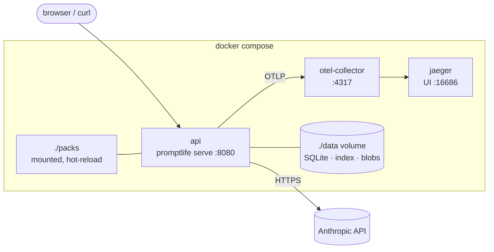
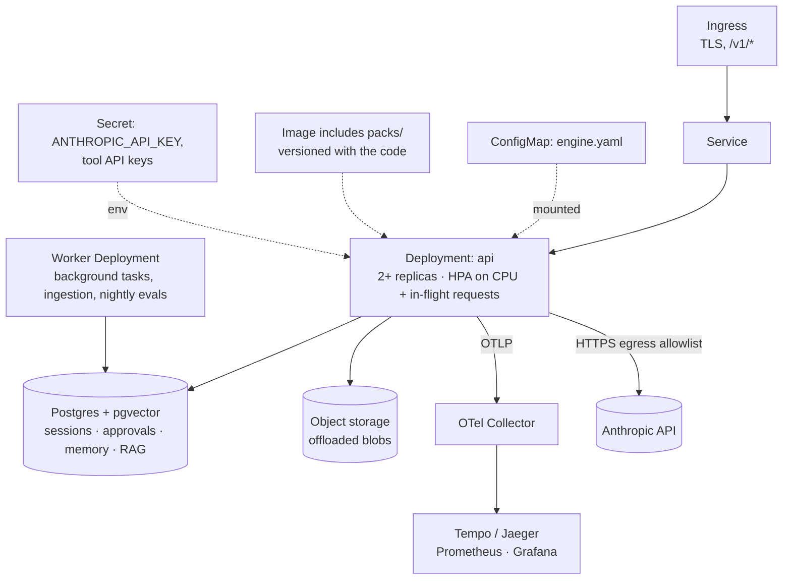
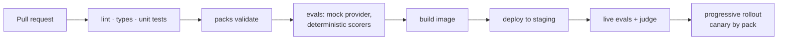

# 10 · Deployment

## Local: Docker Compose

- `make up` starts the stack; with no `ANTHROPIC_API_KEY` in `.env`, the mock provider is used.
- Packs are mounted so edits hot-reload.

## Production: Kubernetes

### Design points

- **Stateless replicas.** All state is in Postgres and object storage
  ([ADR-0006](../adr/0006-state-outside-the-process.md)). SQLite is only for a single
  local container.
- **Packs ship in the image.** A pack change is a normal build and rollout, traced by
  `pack.version`. A ConfigMap can override packs for experiments.
- **Long requests.** SSE responses can take tens of seconds: ingress and service
  timeouts are raised (e.g. 300 s), and the pod's `terminationGracePeriodSeconds`
  covers in-flight runs. On `SIGTERM` the API stops accepting new runs, finishes or
  checkpoints current ones, then exits.
- **Autoscaling** on in-flight requests (custom metric) rather than CPU alone, because
  the work is mostly waiting on the model.
- **Egress**: NetworkPolicy allows only the model API, approved tool APIs, Postgres and
  the collector. MCP stdio servers run inside the pod; remote MCP servers are allowlisted.
- **Secrets** come from a Secret (or an external secrets operator). Nothing secret is in
  `engine.yaml` or packs.
- **Probes**: `/healthz` (process up) and `/readyz` (packs loaded, DB reachable).
- **Background work** (re-indexing knowledge, nightly evals, the stuck-refund sweeper —
  a headless agent from chapter 01) runs in a separate worker Deployment or CronJob.

## Build and release

## Future work

- Multi-tenancy: tenant ID on every row, per-tenant packs and budgets, row-level security.
- Per-tenant cost budgets enforced in the gateway.
- Durable execution (Temporal) for runs that last hours.
