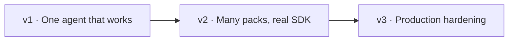

# 12 · Roadmap

Built the way a team grows a real system: each step is added when the previous one
creates the need for it. Each milestone is a set of small PRs with tests.

## v1 — One agent that works

**Why first:** prove the loop end to end before adding platform pieces.

| Step | Delivers | Chapters |
|---|---|---|
| 1.1 | Project skeleton, `engine.yaml`, settings, internal message types | — |
| 1.2 | Gateway with **mock** and **anthropic** providers, aliases, cost | 08–11 |
| 1.3 | Raw agent loop with tools, limits, stop-reason handling | 03 |
| 1.4 | Pack schema + registry; `refunds` pack with Python tools and fixtures | 02, 06 |
| 1.5 | ToolExecutor with policy (deny, approvals, retry classes) | 02, 06 |
| 1.6 | Sessions (SQLite), checkpoints, interrupts + approvals | 03 |
| 1.7 | CLI `ask` / `chat`; HTTP API with SSE | 01 |
| 1.8 | Tests on the mock provider; first `evals.jsonl` with deterministic scorers | 15 |

## v2 — Many packs, real SDK

**Why now:** a second use case appears, and the first one starts to need memory and docs.

| Step | Delivers | Chapters |
|---|---|---|
| 2.1 | `it_helpdesk` pack (proves the engine has no refund assumptions) and `general` pack | 02 |
| 2.2 | Router: explicit → rules → embeddings → LLM; routing evals | 07 |
| 2.3 | Strands backend (same packs, `backend: strands`) | 03 |
| 2.4 | MCP tool source (stdio + HTTP) and OpenAPI tool source | 06 |
| 2.5 | Context builder: injection, sliding window, compaction, offloading | 04 |
| 2.6 | Memory tool and RAG (chunking, hybrid search, citations) | 05 |
| 2.7 | Orchestrator-workers and agent-as-tool; handoff inside a pack | 07 |
| 2.8 | Skills with progressive disclosure | 02 |

## v3 — Production hardening

**Why now:** real traffic means real failures, costs and attacks.

| Step | Delivers | Chapters |
|---|---|---|
| 3.1 | Gateway: retries, fallback chains, rate limits, server-side refusal fallback, response cache | 09, 12 |
| 3.2 | Prompt-cache-aware context ordering + cache hit metrics | 12 |
| 3.3 | Guardrails: injection, PII, grounding, dates | 13 |
| 3.4 | OpenTelemetry tracing + metrics; Jaeger in Compose | 14 |
| 3.5 | LLM judge, nightly live evals, regression report | 15 |
| 3.6 | Dockerfile, Compose stack, Kubernetes manifests, Postgres + pgvector | 16 |
| 3.7 | Expose packs as MCP servers | 06 |
| 3.8 | Sandbox runner for code tools; background worker (headless agent) | 01, 02 |
| 3.9 | A2A client tool source and A2A server for opted-in packs | 07 |
| 3.10 | Polyglot packs: pack build steps, containerized MCP tools, locales | 06 |

## Definition of done (every step)

- Unit tests pass on the mock provider; no network needed.
- Docs updated: the relevant design page and guide.
- New behavior is visible in traces (span or attribute).
- If it touches policy or safety, an eval case covers it.
