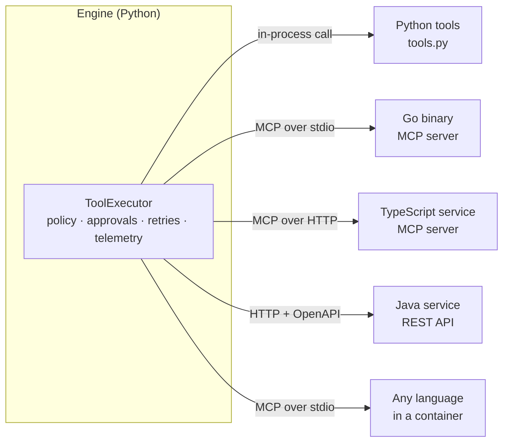
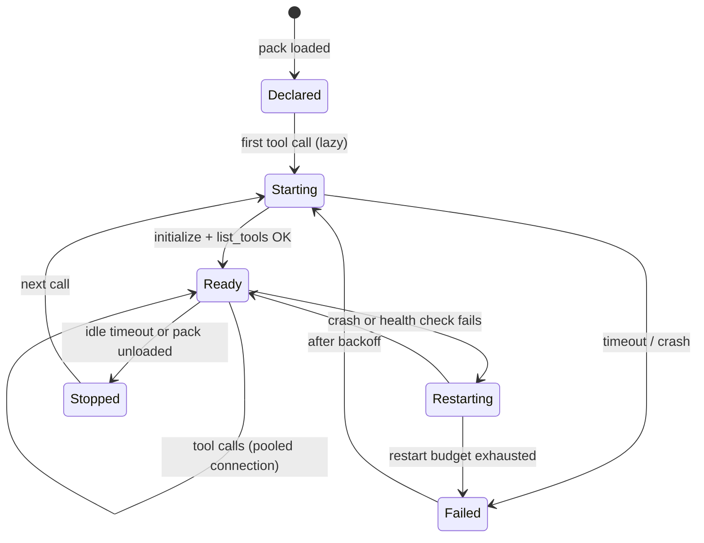
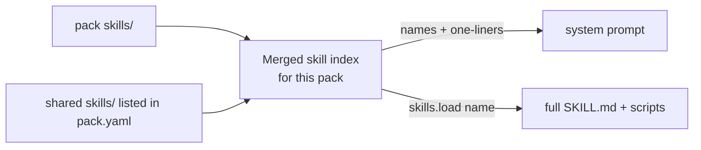

# 13 · Polyglot packs

Packs differ in three ways:

1. **Programming language** of their tools (Python, Go, TypeScript, Java, ...).
2. **Their own MCP servers, skills, knowledge and dependencies.**
3. **Human language** of their users (English, Hindi, German, ...).

The engine handles all three with one rule: **the engine talks to tools only through
language-neutral protocols, and everything a pack brings is scoped to that pack.**

## 1. Tools in any programming language



| Tool language | Recommended integration | Why |
|---|---|---|
| Python | `- python: tools.py` | in-process, simplest, fastest to write |
| Go, Rust, TypeScript, Java, ... | **MCP server** (stdio for local binaries, streamable HTTP for services) | MCP is the standard tool protocol; official SDKs exist for most languages; schemas come for free |
| Existing REST service | `- openapi:` | no new code; reuse the service's spec |
| Anything with heavy or conflicting dependencies | MCP server **in its own container** | isolation; the engine image stays small |

Python is a convenience, not a requirement. The `ToolExecutor` treats all sources the
same, so policy, approvals, retries and tracing work identically across languages.

Example: a Go tool for the `it_helpdesk` pack.

```
packs/it_helpdesk/
  pack.yaml
  mcp/k8s-tools/          Go module: main.go, go.mod (an MCP server)
```

```yaml
tools:
  - mcp:
      name: k8s
      command: ./mcp/k8s-tools/bin/k8s-tools     # built by `make packs`
      include: [get_pods, get_events, restart_deployment]
policies:
  side_effect_tools: [k8s__restart_deployment]
  require_approval: [k8s__restart_deployment]
```

### Building and shipping non-Python tools

| Environment | How the tool is built | How it runs |
|---|---|---|
| Local dev | `make packs` runs each pack's `build:` command | subprocess (stdio) |
| CI | same build step; artifacts cached by content hash | subprocess in tests |
| Kubernetes | multi-stage Dockerfile copies built binaries into the image, **or** the tool runs as its own Deployment/sidecar | stdio subprocess, or HTTP to a Service |

```yaml
# pack.yaml
build:
  - cmd: go build -o mcp/k8s-tools/bin/k8s-tools ./mcp/k8s-tools
    when_changed: mcp/k8s-tools/**
runtime:
  k8s:
    mode: sidecar            # subprocess | sidecar | service
    image: ghcr.io/acme/k8s-tools:1.4.0
```

## 2. Per-pack MCP servers, skills and dependencies

Everything a pack declares belongs to that pack:

| Resource | Scoping rule |
|---|---|
| MCP servers | started per pack, names prefixed (`k8s__get_pods`), never visible to other packs unless they declare the same server |
| Skills | `packs/<name>/skills/`; a pack can also import shared skills from `skills/` at the repo root with `skills: { path: skills/, shared: [carrier-tracking] }` |
| Knowledge / RAG index | one index namespace per pack |
| Memory | scoped by `(user_id, pack)` unless the pack opts into shared memory |
| Secrets | the pack can read only the secrets it declares in `pack.yaml` |
| Python dependencies | declared in the pack (`requirements:`); checked at validation; conflicting or heavy deps → move the tools behind MCP in a container |
| Limits and cost | per pack |

### MCP server lifecycle



- **Lazy start**: servers start on first use, so 20 packs with 40 MCP servers don't all
  boot at startup.
- **Shared when identical**: two packs declaring the same server with the same command,
  args and env share one process (keyed by a hash of the config), but each pack still
  sees only the tools it `include`s.
- **Health and restarts**: crashed servers restart with backoff; tool calls during a
  restart get a retryable error.
- **Tool list caching**: `list_tools` results are cached per server version, so tool
  definitions stay byte-stable for prompt caching.
- **Allowlist**: production only runs MCP commands and URLs listed in
  `engine.yaml: mcp.allow`.
- **Too many tools**: when a pack exposes many tools, the engine sends short summaries
  and loads full definitions on demand (progressive disclosure; or the API's tool search
  with `defer_loading`).

### Skill resolution



Name collisions: the pack's own skill wins over a shared one, and validation warns.

## 3. Human languages

| Concern | Design |
|---|---|
| Detect language | cheap detector on input (or `Accept-Language`, or user profile); stored in session state as `locale` |
| Routing | pack `examples` can be multilingual; the embedding router uses a multilingual embedder; the LLM router handles any language |
| Prompts | one `prompt.md`, plus an instruction "reply in the user's language" injected from `locale`; optional `prompt.<locale>.md` overrides for regulated wording |
| Supported locales | `locales: [en, hi, de]` in `pack.yaml`; unsupported locales get a polite reply in the closest supported language |
| Knowledge | documents tagged with `lang`; retrieval prefers the user's language and falls back to English; multilingual embeddings so a Hindi question can match an English policy |
| Tool data | tools return structured data, not prose, so formatting (dates, currency) is done by the model in the user's locale |
| Guardrails | PII patterns per region (Aadhaar, IBAN, SSN); injection heuristics in each supported language plus the model-based check |
| Evals | eval cases tagged with `locale`; reports break scores down by locale |

```yaml
# pack.yaml
locales: [en, hi, de]
prompt:
  template: prompt.md
  overrides: { de: prompt.de.md }     # legal wording for German customers
knowledge:
  path: knowledge/
  languages: [en, de]
```

## Summary

| Packs differ by... | The engine handles it with... |
|---|---|
| tool programming language | MCP and OpenAPI as the language-neutral boundary; Python in-process only as a convenience |
| their own MCP servers | per-pack, lazily started, pooled, prefixed, allowlisted servers |
| their own skills | per-pack skill index with optional shared skills |
| dependencies | pack-declared; heavy or conflicting ones move into a containerized MCP server |
| human language | locale in session state, multilingual routing and retrieval, per-locale prompts, guardrails and evals |
