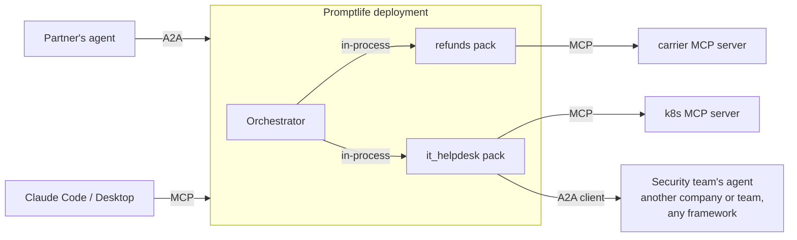

# 14 · Interoperability: MCP and A2A

Two open protocols, two different jobs:

| | MCP (Model Context Protocol) | A2A (Agent2Agent protocol) |
|---|---|---|
| Connects | an agent ↔ **tools, data and prompts** | an agent ↔ **another agent** |
| The other side is | a capability with a schema (a function call) | an autonomous peer with its own model, tools and policies |
| Interaction | request → result, usually fast | **tasks** with a lifecycle (submitted → working → input-required → completed), streaming updates, artifacts, possibly long-running |
| Discovery | `list_tools` on a server you configured | an **Agent Card** (JSON at a well-known URL) describing skills, endpoints and auth |
| Analogy | a library or REST API | a microservice owned by another team |

Rule of thumb: **if you would describe it as a function, use MCP; if you would describe
it as a colleague you delegate to, use A2A.**

## Where each protocol sits in Promptlife



| Situation | Mechanism |
|---|---|
| Agents inside one Promptlife deployment | **in-process** (agent-as-tool, handoff, orchestrator). No network hop, shared tracing, one policy engine. |
| A pack needs tools or data | **MCP** client (see [06](06-tools-and-policy.md), [13](13-polyglot-packs.md)) |
| A pack delegates to an agent run by another team or vendor | **A2A client** — the remote agent becomes a tool source |
| Another team's agent wants to use our packs | **A2A server** — each pack published with an Agent Card |
| A developer wants to use a pack from Claude Code / Desktop | **MCP server** exposing `ask_<pack>` |

We do **not** use A2A between our own packs: in-process calls are cheaper, faster and
easier to trace. A2A is for crossing an ownership or trust boundary.

## A2A as a tool source (client side)

```yaml
# packs/it_helpdesk/pack.yaml
tools:
  - a2a:
      name: security_agent
      card_url: https://security-agent.internal.example.com/.well-known/agent-card.json
      auth: { bearer: SECURITY_AGENT_TOKEN }
      skills: [triage_alert]          # optional allowlist from the Agent Card
      timeout_s: 120
policies:
  side_effect_tools: [security_agent__triage_alert]   # treat remote agents as side-effecting by default
```

- At load time the engine fetches the Agent Card and turns each allowed **skill** into a
  tool `security_agent__<skill>(message)`.
- A call creates an A2A **task**. Streaming status updates are forwarded as
  `tool_progress` events; artifacts become the tool result.
- `input-required` from the remote agent becomes an **interrupt** in our run, so a human
  (or the calling agent) can answer, just like an approval.
- Long tasks: the run checkpoints and resumes when the task completes (push
  notification or polling), using the same machinery as approvals.
- All the usual controls apply: policy, approvals, timeouts, cost and turn limits,
  output redaction, and treating the remote agent's output as **untrusted input**
  (indirect prompt-injection risk).

## Packs as A2A agents (server side)

`promptlife a2a serve` (or `a2a.enabled: true` in `engine.yaml`) publishes each
opted-in pack:

```yaml
# pack.yaml
a2a:
  expose: true
  skills:
    - id: refund_status
      description: Explain the status of a customer's refund.
      examples: ["Where is the refund for order 4417?"]
  auth: [oauth2]
```

- **Agent Card** at `/a2a/<pack>/.well-known/agent-card.json`, generated from the pack
  card and the `a2a.skills` list.
- Incoming A2A tasks map onto normal pack runs: task ID ↔ session, `input-required` ↔
  interrupt, streaming ↔ our SSE events, final answer ↔ artifact.
- The caller's identity comes from A2A auth and becomes the run's `user_id`, so tool
  scoping and approvals still apply.
- Rate limits and cost caps apply per calling agent.

## Implementation notes

- Strands Agents has A2A support (serving an agent over A2A and calling remote A2A
  agents). The `strands` backend can use it; the engine still wraps remote agents as a
  tool source so policy and telemetry stay engine-owned.
- The raw backend uses the A2A Python SDK directly through the same tool-source
  interface.
- Trace context is propagated over both MCP (HTTP) and A2A calls with W3C
  `traceparent`, so a delegation to another team's agent shows up in one trace when
  both sides run OpenTelemetry.

## Roadmap placement

- v2.4: MCP client (already planned).
- v3.7: MCP server (already planned).
- **v3.9: A2A client tool source and A2A server for opted-in packs.**
